# Final Project: accumulatorA

Ali Behbehani, VLSI, University of Denver, Fall 2026

Electric VLSI, mocmos, 300 nm scale (λ = 0.3 µm), 3 metal layers, VDD = 5 V. I built accumulatorA from the Very Simple Microprocessor (VSM) in Electric, using the muddLib07 standard cells plus a D flip-flop I made from muddLib07 gates. I drew the schematic and the layout, checked them with DRC and NCC, and simulated both in ngspice with the cmosedu models.

## What accumulatorA does

accumulatorA is the A register of the VSM. It holds the 4-bit A number for the ALU and can put that number on the internal bus.

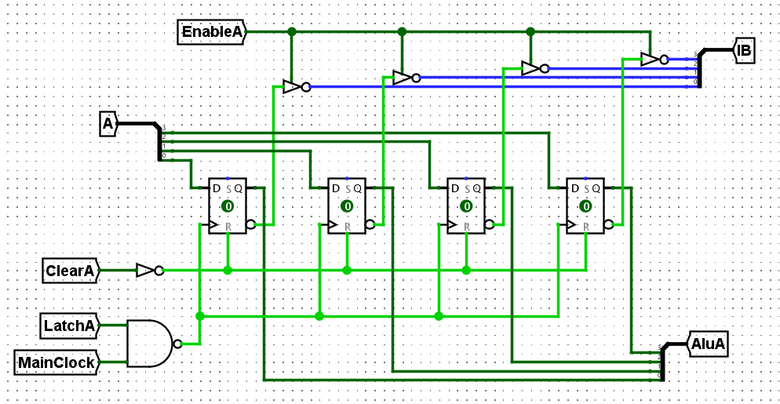

This is the circuit from the final project handout (Logisim). My Electric version has the same gates and the same wiring.

| Pin | Direction | What it does |
|---|---|---|
| A[3:0] | in | the number to store |
| MainClock | in | the clock |
| LatchA | in | 1 = load A on the clock edge, 0 = keep the old value |
| ClearA | in | 0 = clear the register to 0000 right away |
| EnableA | in | 1 = drive IB, 0 = let go of the bus |
| AluA[3:0] | out | the stored value, always going to the ALU |
| IB[3:0] | out | the stored value on the internal bus (tri-state) |

- The clock of all 4 flip-flops is NAND(LatchA, MainClock). So the flip-flops only get a clock edge when LatchA is 1, and they load when MainClock falls.
- ClearA goes through a NOT gate to the reset (R) of every flip-flop.
- Q of each flip-flop goes to AluA. Qb goes into an inverting tri-state, so IB is the stored value again.

## Cells

| Cell | Transistors | From |
|---|---|---|
| nand2_1x | 4 | muddLib07 |
| nand3_1x | 6 | muddLib07 |
| inv_1x | 2 | muddLib07 |
| invtri_c_1x (inverting tri-state) | 6 | muddLib07 |
| dff (D flip-flop) | 34 | made by me from the gates above |
| accumulatorA | 166 | made by me |

### muddLib07 gates

| Cell | Schematic | Layout |
|---|---|---|
| nand2_1x | 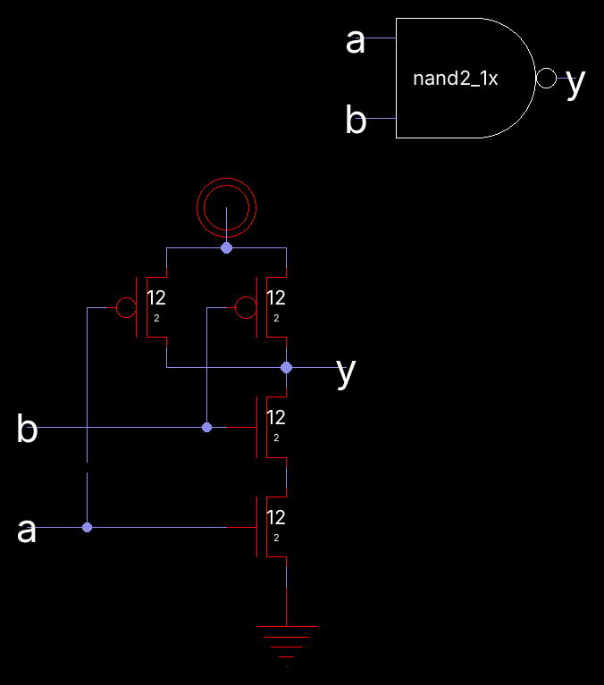 | 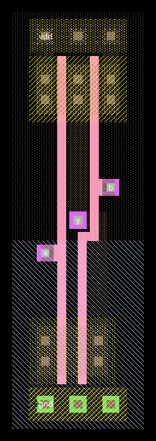 |
| nand3_1x | 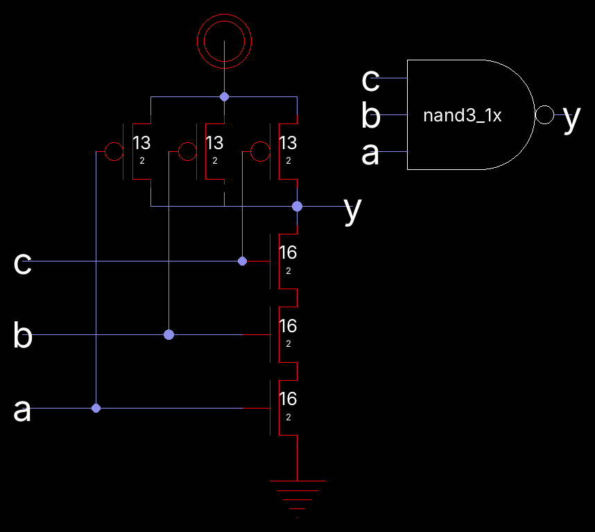 | 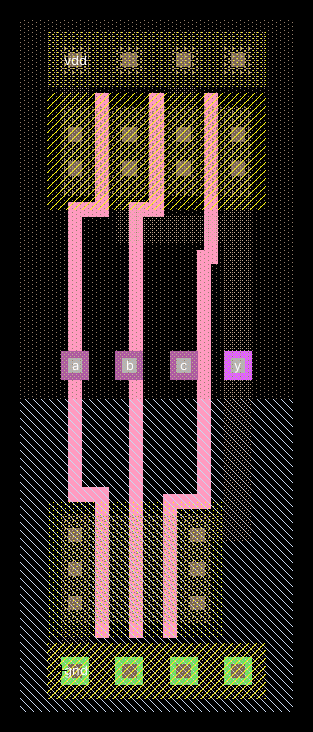 |
| inv_1x | 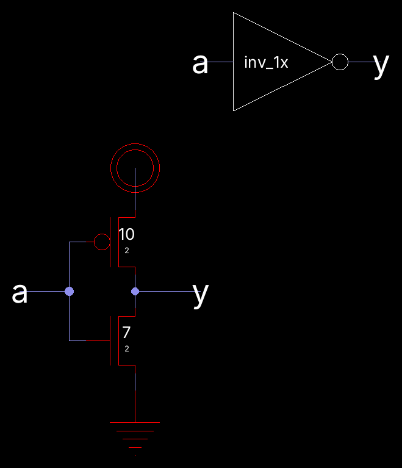 | 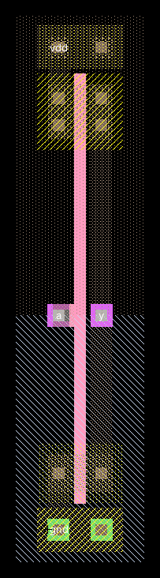 |
| invtri_c_1x | 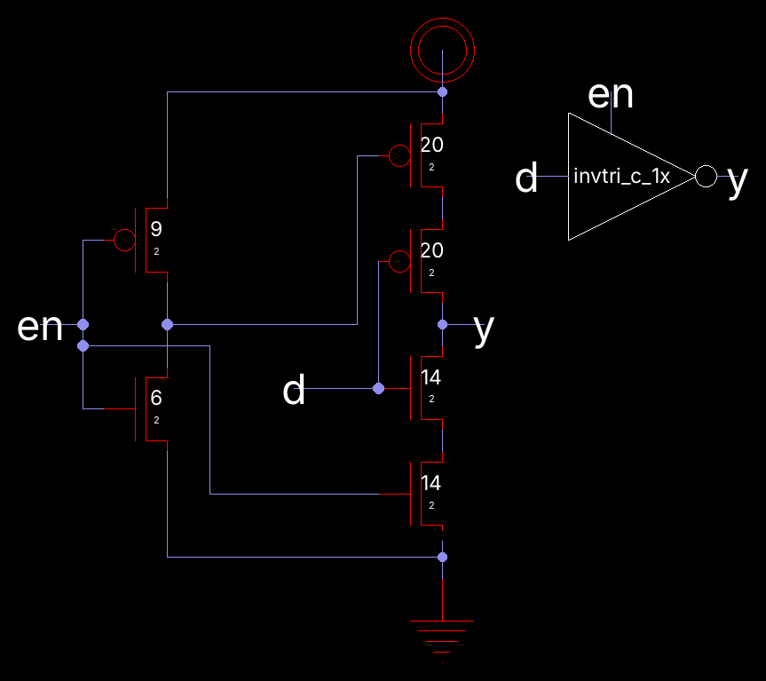 | 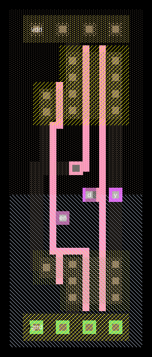 |

### My D flip-flop (dff)

The flip-flop in the handout circuit has Q, Qb and a reset that clears it right away. muddLib07 does not have one like that (its flopr_c_1x only has Q and its reset waits for the clock), so I built my own from muddLib07 gates. It is the classic 6-NAND rising-edge D flip-flop (the same circuit as a 7474 chip):

- 4 NAND gates (n1 to n4) make the edge-triggered part. Q only changes on the rising edge of clk.
- 2 NAND gates make the Q / Qb output latch.
- R goes through an inverter to clrb, which goes to 3 of the NANDs. R = 1 forces Q = 0 and Qb = 1 right away, without waiting for the clock.

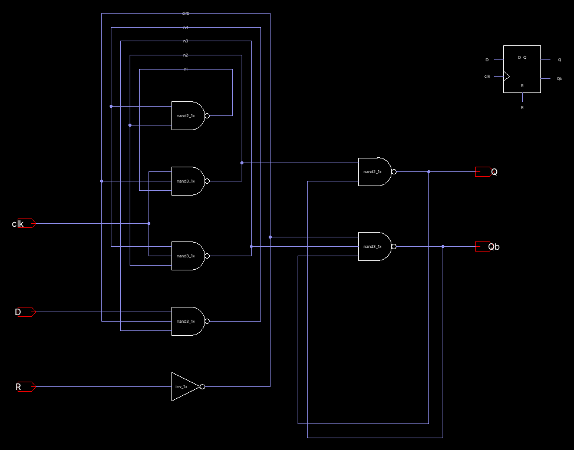

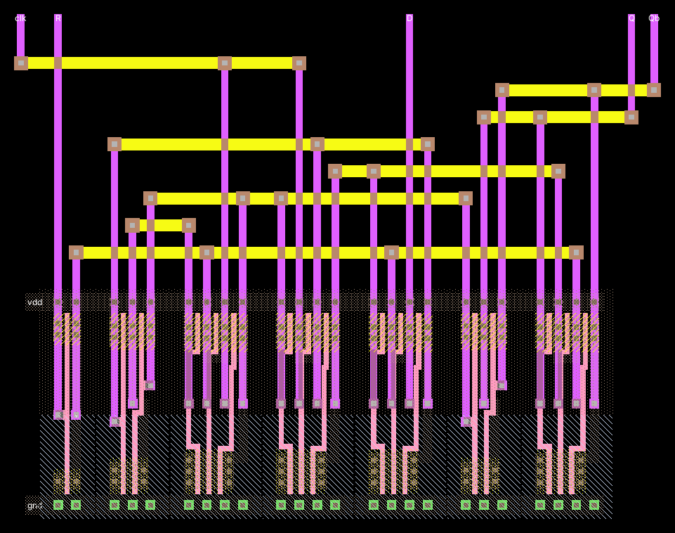

The layout is the 7 gates in a row. Each gate pin goes straight up on metal 2, and the nets meet on metal 3 tracks above the row.

3D view of the flip-flop:

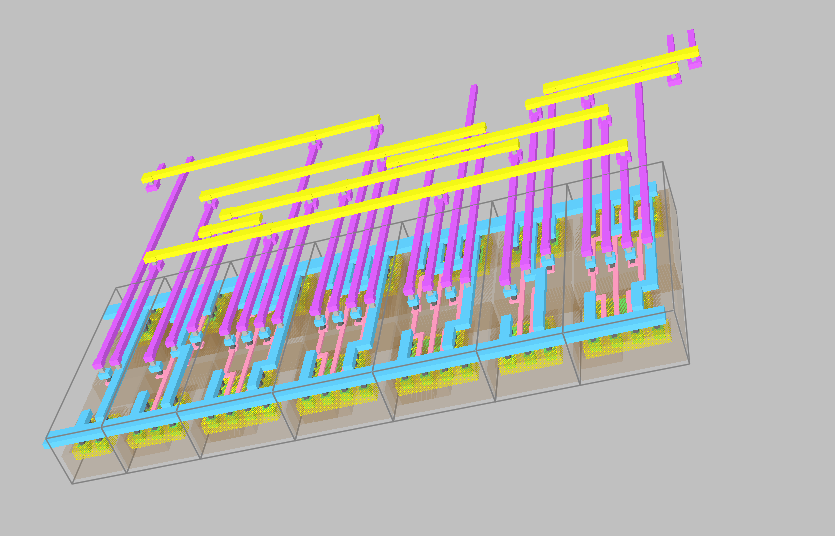

Flip-flop test (dff_sim): the clock period is 20 ns, D goes high at 25 ns and low at 95 ns, and R is high from 52 to 56 ns.

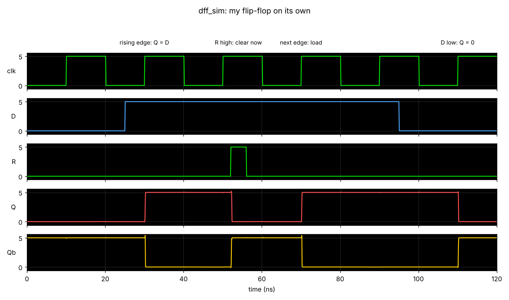

| Time | What happens | Q | Qb |
|---|---|---|---|
| 30 ns | rising edge with D = 1 | 1 | 0 |
| 52 ns | R goes high, no clock edge | 0 right away | 1 |
| 70 ns | next rising edge, D still 1 | 1 | 0 |
| 110 ns | rising edge with D = 0 | 0 | 1 |

## accumulatorA schematic

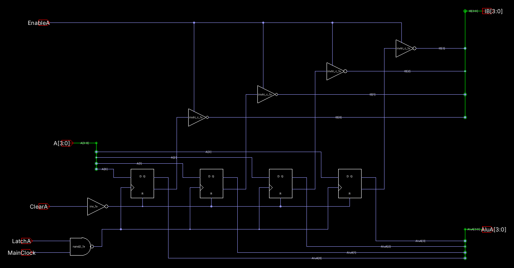

I drew it the same way as the handout: EnableA across the top, the 4 inverting tri-states going up into the IB bus, A[3:0] coming in as a bus and dropping into each D, Qb going up to the tri-states, Q going down into the AluA bus, ClearA through the NOT to R, and LatchA and MainClock through the NAND to the clocks.

### Icon and test bench

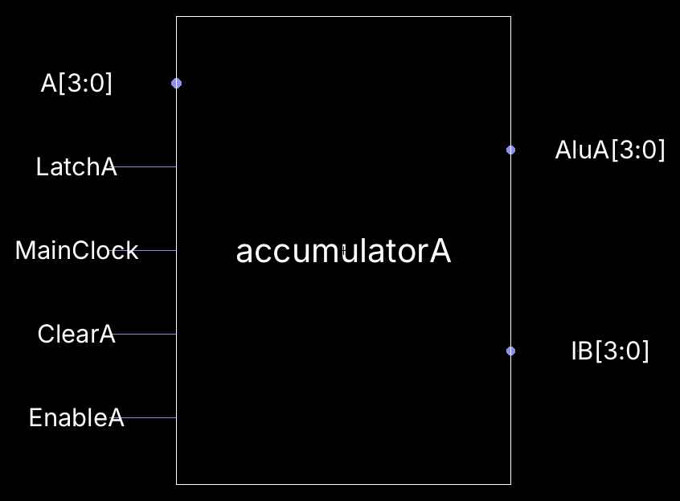

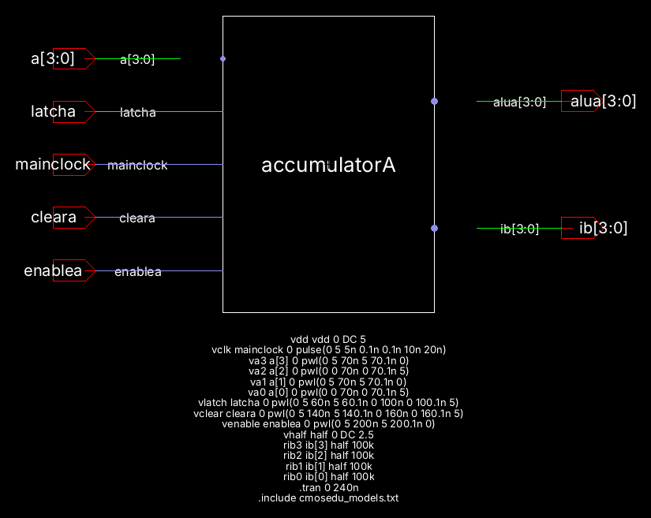

## Layout

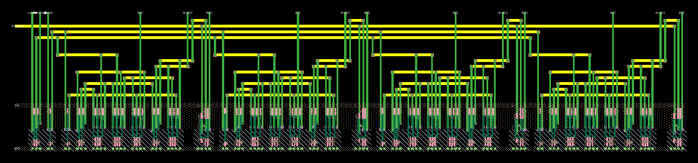

- One row of cells: nand2_1x (clock), inv_1x (the NOT on ClearA), then a dff and an invtri_c_1x for each bit.
- vdd and gnd run straight across the row on metal 1, and one n-well covers the whole row.
- Each pin goes straight up on metal 2. The shared signals (clock, R, EnableA, and each Qb to its tri-state) run sideways on metal 3 tracks above the cells.
- All the inputs and outputs are metal 2 pins on the top edge. EnableA comes in on the left end of its track, and vdd and gnd are on the left end of the rails.
- Size: 1398λ × 294λ (419 µm × 88 µm).

Zoom on the left end (clock NAND, ClearA inverter, first flip-flop and tri-state):

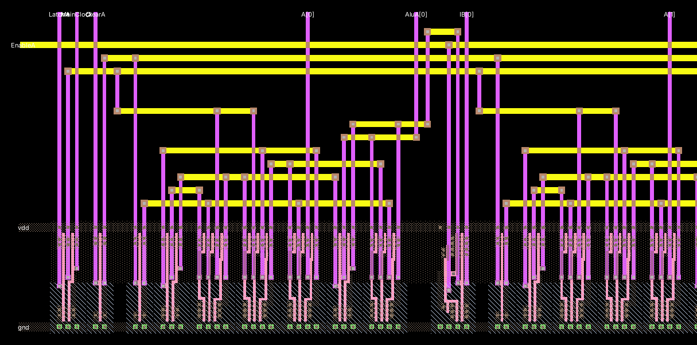

3D view:

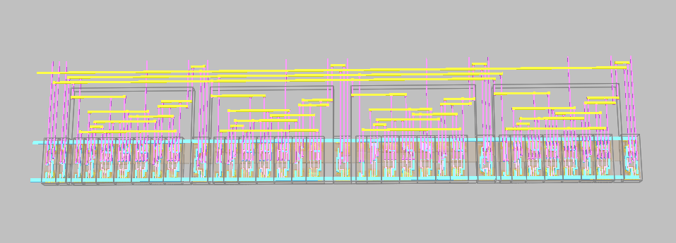

## DRC and NCC

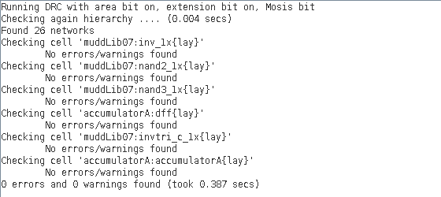

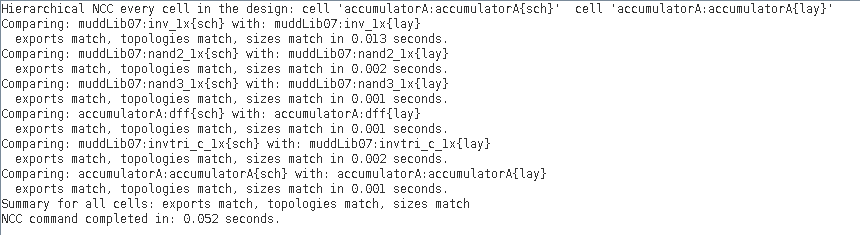

| Check | Result |
|---|---|
| DRC accumulatorA (and every cell inside it) | 0 errors, 0 warnings |
| NCC accumulatorA, hierarchical, sizes checked | match |
| NCC dff | match |

## Simulation

The test bench (accumulatorA_sim) holds the accumulatorA icon and this spice card:

```
vdd vdd 0 DC 5
vclk mainclock 0 pulse(0 5 5n 0.1n 0.1n 10n 20n)
va3..va0: A = 1010 until 70 ns, then 0101
vlatch latcha 0 pwl(0 5 60n 5 60.1n 0 100n 0 100.1n 5)
vclear cleara 0 pwl(0 5 140n 5 140.1n 0 160n 0 160.1n 5)
venable enablea 0 pwl(0 5 200n 5 200.1n 0)
vhalf half 0 DC 2.5
rib3..rib0: 100k from each IB to 2.5 V (so a floating IB shows up as 2.5 V)
.tran 0 240n
.include cmosedu_models.txt
```

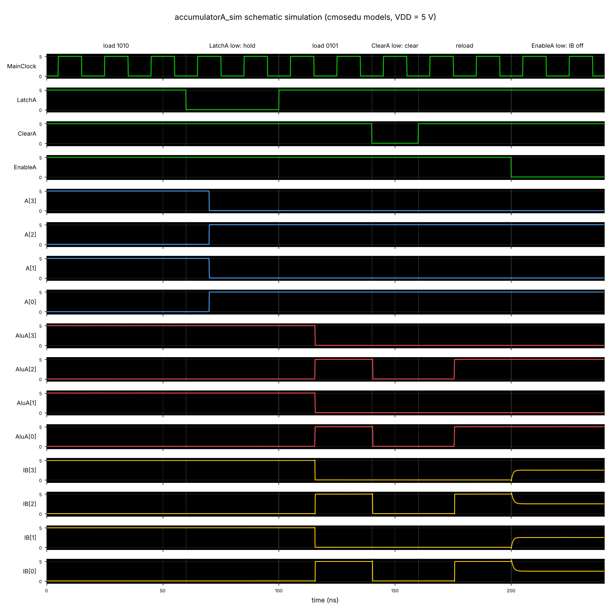

| Time | What I expect | AluA[3:0] | IB[3:0] |
|---|---|---|---|
| 19 ns | load A = 1010 at the 15 ns edge | 1010 | 1010 |
| 79 ns | LatchA = 0, A changed to 0101, hold | 1010 | 1010 |
| 119 ns | LatchA = 1 again, load 0101 | 0101 | 0101 |
| 141 ns | ClearA = 0 at 140 ns, clear right away | 0000 | 0000 |
| 179 ns | ClearA = 1, load 0101 at the 175 ns edge | 0101 | 0101 |
| 219 ns | EnableA = 0, IB lets go | 0101 | 2.5 V (floating) |

Everything matches. The register loads when MainClock falls, because that is when the NAND output (the flip-flop clock) rises.

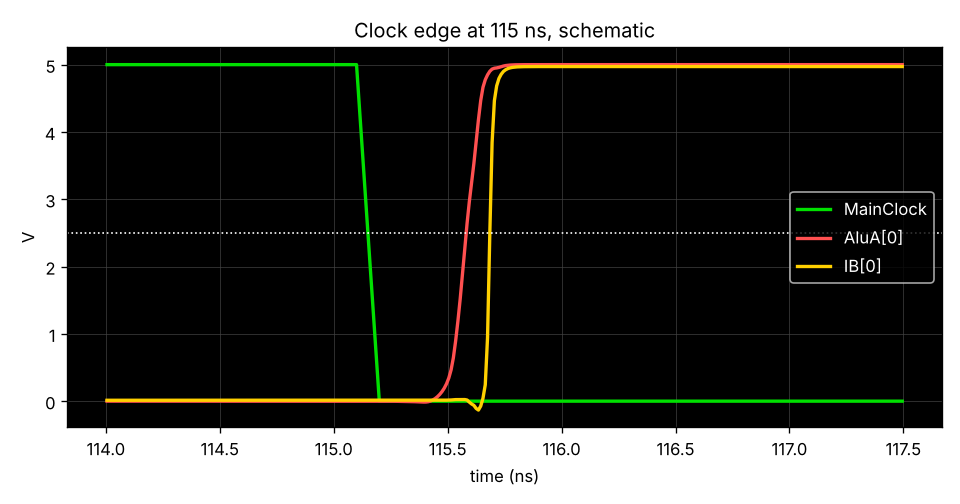

| Delay (50% to 50%) | Schematic |
|---|---|
| MainClock falling to AluA | 0.43 ns |
| MainClock falling to IB | 0.54 ns |
| ClearA falling to AluA clearing | 0.43 ns |

## Layout simulation

accumulatorA_sim{lay} has the layout inside it with the same spice card. The netlist Electric writes from the layout includes the source and drain areas of every transistor, so it adds the junction capacitance the schematic does not have. The layout netlist names its transistors N and P, so its card includes cmosedu_layout.txt, which is the same cmosedu N_1u / P_1u models under those names.

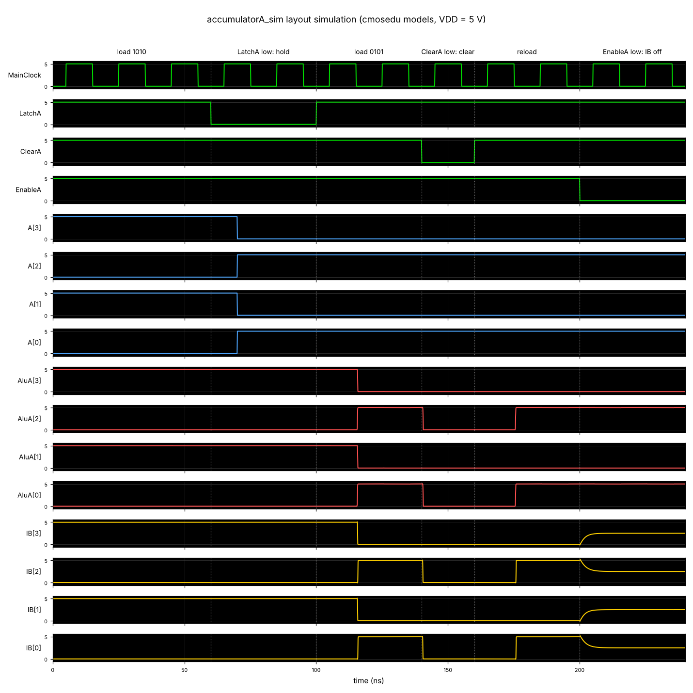

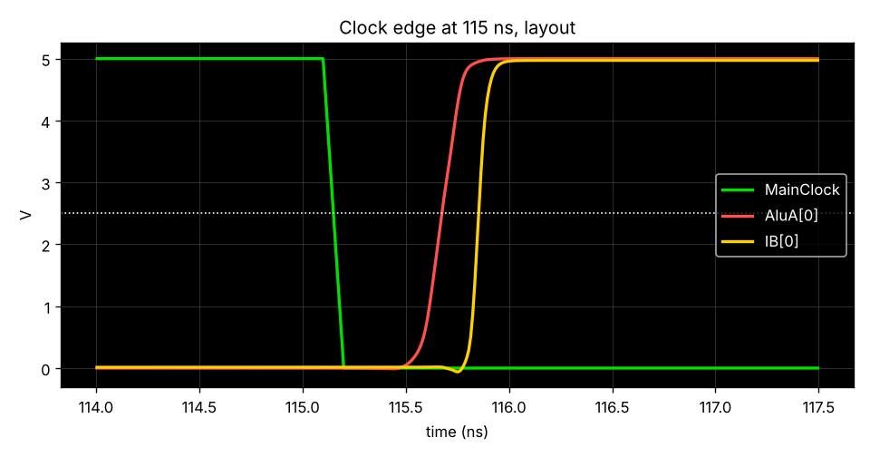

| | Schematic | Layout |
|---|---|---|
| All 6 checkpoints above | correct | correct (same values) |
| MainClock to AluA | 0.43 ns | 0.53 ns |
| MainClock to IB | 0.54 ns | 0.70 ns |
| ClearA to AluA | 0.43 ns | 0.54 ns |

The layout is a little slower because of the extra junction capacitance, which is what I expected.

## Notes

- muddLib07 is drawn with the alternate active and poly rules, so I turned on "Alternate Active and Poly contact rules" in Electric's Technology preferences. Without it, DRC shows errors inside the library cells themselves.
- I made 3 changes to my copy of muddLib07: I added the cmosedu model names (N_1u, P_1u) to the transistors of the 4 gates I use, set their layouts to open expanded, and swapped the a and c labels on the nand3_1x schematic. The nand3_1x schematic stacks its nMOS transistors a-b-c from the top while its layout stacks them c-b-a, so NCC failed on the library cell by itself. Swapping the labels makes them match. A NAND gives the same output for any order of its inputs, so the logic does not change.
- I ran the simulations in ngspice. ngspice does not accept a time step of 0 in .tran, so in sim/ I made a copy of each deck (the _ngspice.cir files) with .tran 10p instead and a few plot commands at the end. Nothing else in the decks is changed.
- Keep accumulatorA.jelib, muddLib07.jelib and the two model files in the same folder, so the library and the .include lines find them.

## Files

| File | What it is |
|---|---|
| accumulatorA.jelib | my library: accumulatorA (sch, icon, layout), dff (sch, icon, layout), accumulatorA_sim (sch, layout), dff_sim |
| muddLib07.jelib | the class standard cell library, with the changes in Notes |
| cmosedu_models.txt | cmosedu models (N_1u, P_1u) for the schematic test benches |
| cmosedu_layout.txt | the same models named N and P for the layout test bench |
| sim/ | the spice decks Electric wrote for the 3 test benches, the ngspice copies I ran, and the model files |
| images/ | pictures and plots |
