# Lab 1: R-2R Resistor Ladder (DAC)

Ali Behbehani, VLSI, University of Denver, Fall 2026

Electric VLSI, mocmos, 300 nm scale, VDD = 5 V. I designed a 5-bit R-2R ladder DAC using a 10k n-well resistor, drew the layout, and checked it with DRC and NCC. The library is lab_1_dac (in lab1.zip).

1 LSB = VDD / 2^5 = 5 / 32 = 0.15625 V

## Schematic

### R_Divider schematic

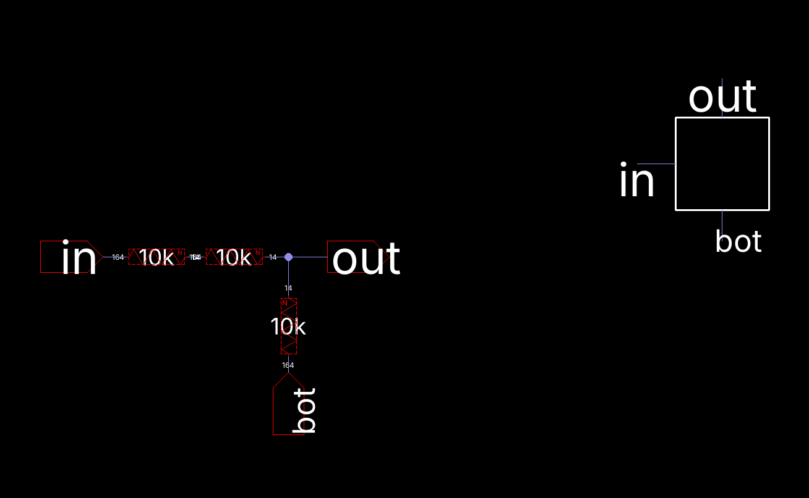

- One step of the ladder. in goes through two 10k resistors in series (the 2R) to out, and one 10k (the R) goes from out down to bot.
- The 2R is two separate 10k resistors in series, like the directions ask.
- The icon has in on the left, out on top and bot on the bottom.

### R_Divider spice test (R_divider_sim)

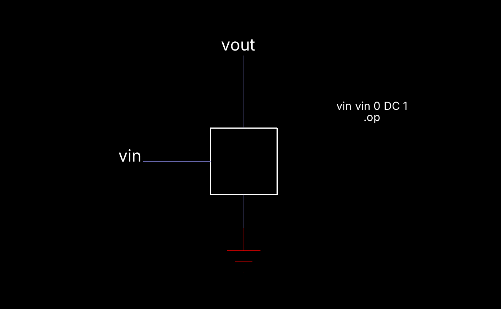

vin = 1 V, bot is grounded. out sees 20k on top and 10k on the bottom, so vout = 1 × 10k / 30k = 0.333 V.

### DAC schematic (5Bit_DAC)

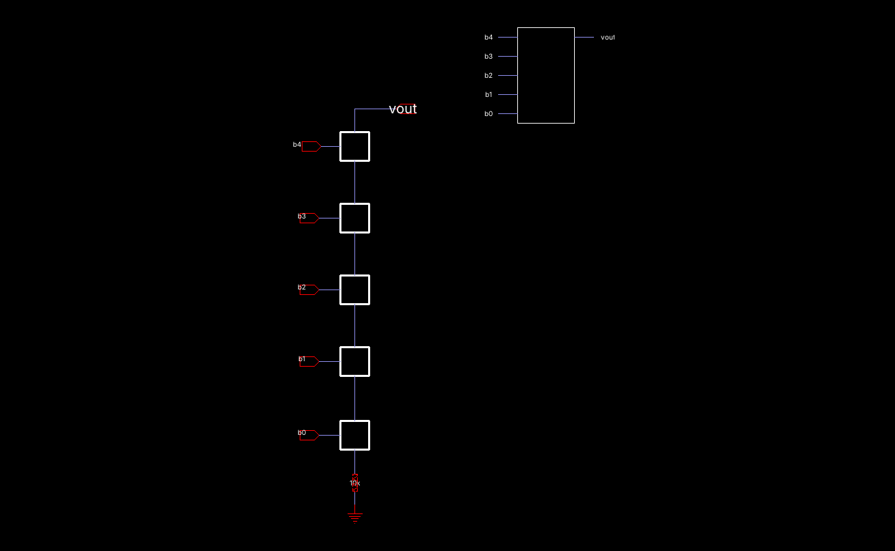

- Five R_divider cells stacked, b4 at the top and b0 at the bottom.
- The out of each cell goes to the bot of the cell above it. The out of the top cell is vout.
- The bot of the b0 cell goes to ground through one more 10k, so the bottom of the ladder sees 2R.

### DAC spice test (5Bit_DAC_op)

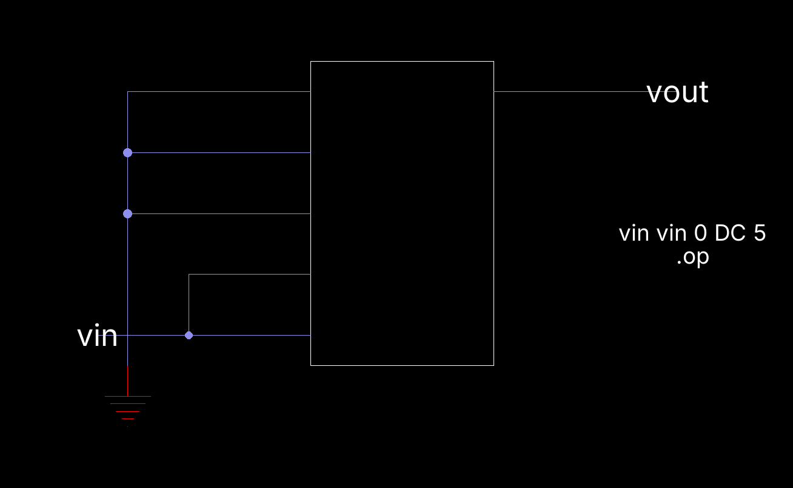

b1 and b0 are tied to vin (5 V) and b4, b3, b2 are grounded, so the input is 00011 = 3.

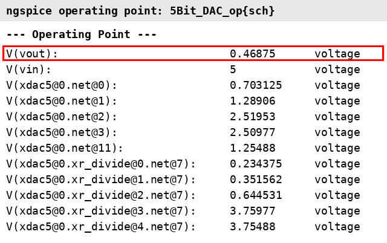

3 × 0.15625 = 0.46875 V, so it matches.

### Checking other inputs on the DAC

| b4 b3 b2 b1 b0 | Expected | Simulated |
|---|---|---|
| 0 0 0 0 0 | 0 V | 0 V |
| 0 0 0 0 1 | 0.15625 V | 0.15625 V |
| 0 0 0 1 1 | 0.46875 V | 0.46875 V |
| 0 0 1 0 0 | 0.625 V | 0.625 V |
| 0 1 0 0 0 | 1.25 V | 1.25 V |
| 1 0 0 0 0 | 2.5 V | 2.5 V |
| 1 0 1 0 1 | 3.28125 V | 3.28125 V |
| 1 1 1 1 1 | 4.84375 V | 4.84375 V |

Every input gives the right output.

### Output resistance of the DAC

- To find it, I ground all the inputs (a voltage source becomes a short) and look back into vout.
- At the bottom, the last R plus the 10k to ground is 2R, and that is in parallel with the 2R from b0, which gives R.
- Every step up does the same thing: R + R = 2R, in parallel with 2R, which is R again.
- At the top, vout sees 2R in parallel with 2R, so R_out = R = 10k for any input.

### Delay driving a 10 pF load, pulse test (5Bit_DAC_sim)

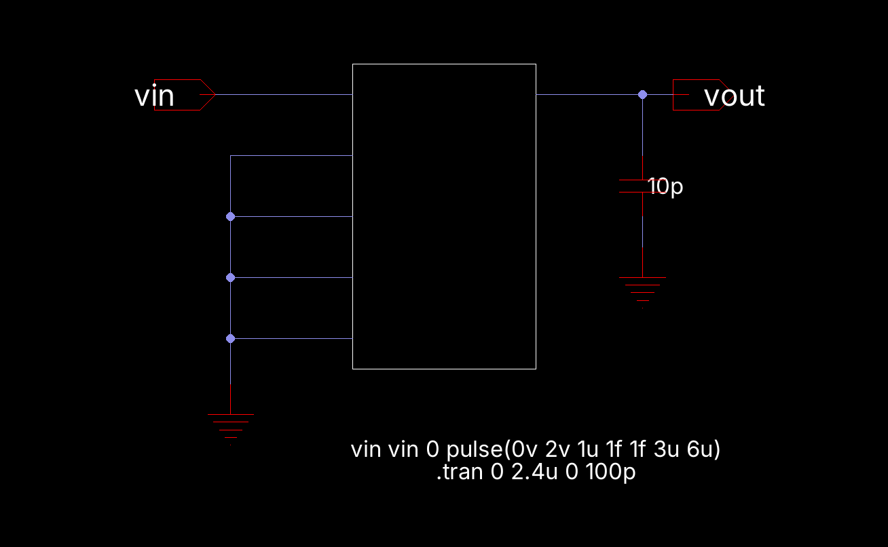

All inputs are grounded except b4, which gets a pulse from 0 to 2 V. There is a 10 pF cap on vout.

Hand calculation:

- vout settles at 2 V / 2 = 1 V (b4 alone is half of the input).
- The DAC looks like a 10k resistor driving the cap, so RC = 10k × 10 pF = 100 ns.
- Delay = 0.7RC = 0.7 × 100 ns = 70 ns.

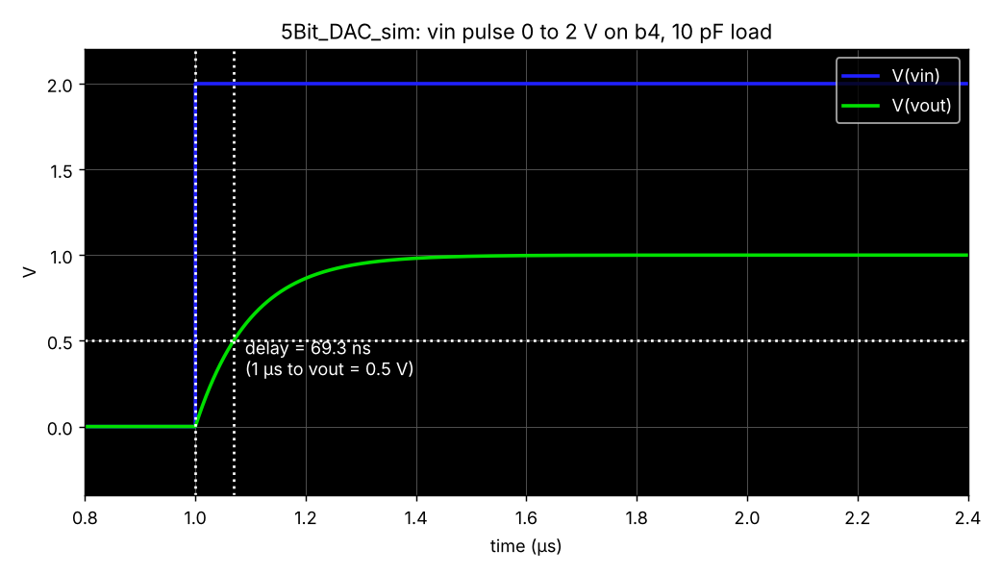

| | Hand calculation | Simulation |
|---|---|---|
| Delay (0.7RC) | 70 ns | 69.3 ns |
| Final vout | 1 V | 1 V |

The simulation matches my hand calculation.

### DAC driving a 10k load (5Bit_DAC_load)

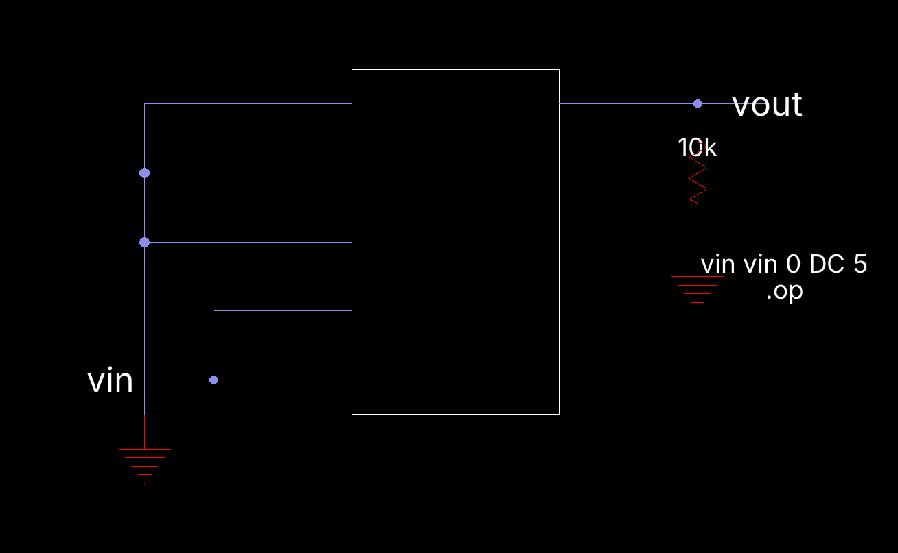

- The DAC has a 10k output resistance, so a 10k load makes a voltage divider and the output is cut in half.
- With input 00011, vout drops from 0.46875 V to 0.234375 V.

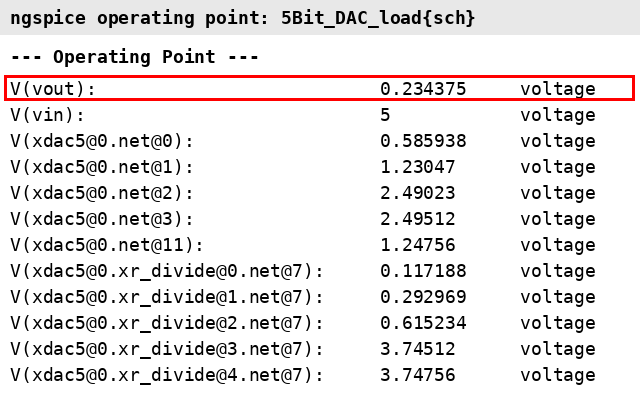

## Layout

Every layout cell is shown expanded so you can see what is inside, not just the symbol.

### 10k n-well resistor, selecting W and L

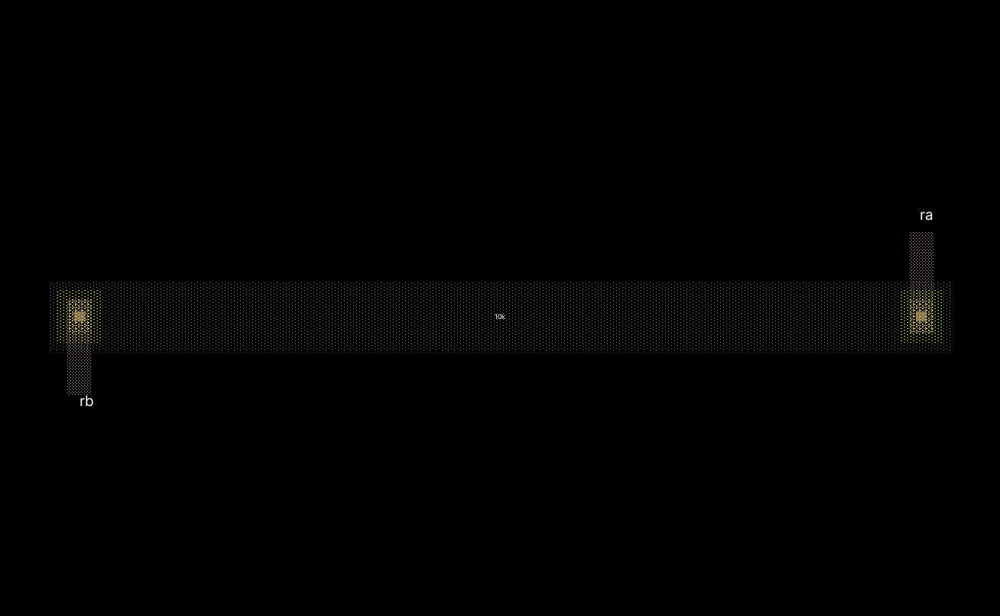

- R = R_sheet × L / W. The n-well is about 850 Ω per square, so 10k needs about 11.7 squares (L / W).
- I used W = 14λ (4.2 µm) and L = 164λ (49.2 µm), which is 11.7 squares.
- I did not use the minimum width, because small errors at the edges would change the resistance more. I also did not make it too wide, because then it has to be very long and takes up a lot of area.
- Every resistor in the DAC is this same resistor, so they all match.

### R_Divider layout

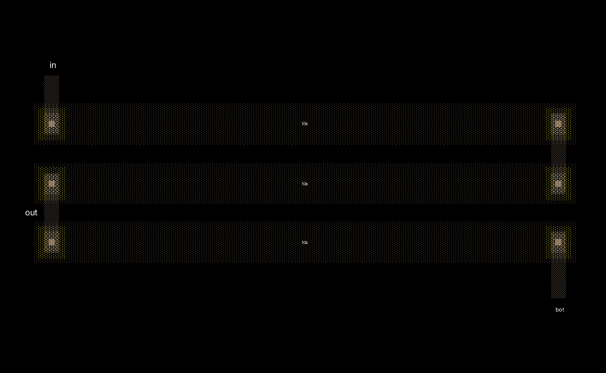

- Three resistors stacked, all at the same x position.
- in is the top left. The top right connects down to the middle resistor, the middle left is out, and out connects down to the bottom resistor. bot is the bottom right.

3D view:

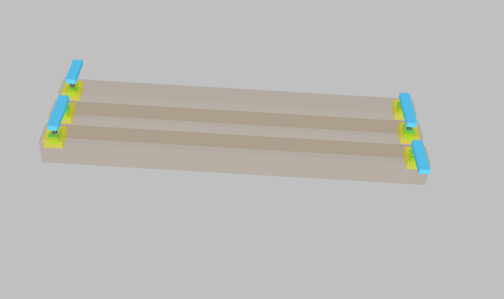

### R_Divider layout spice test (R_divider_sim)

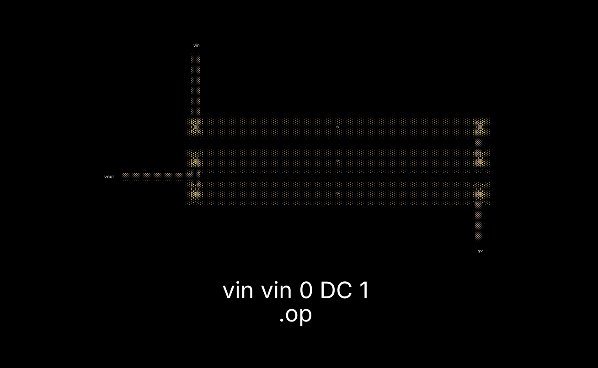

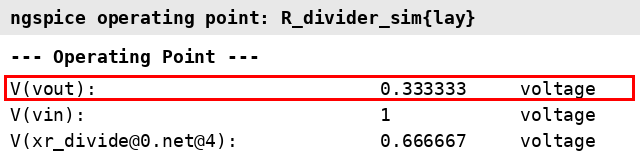

Same as the schematic.

### DAC layout (5Bit_DAC)

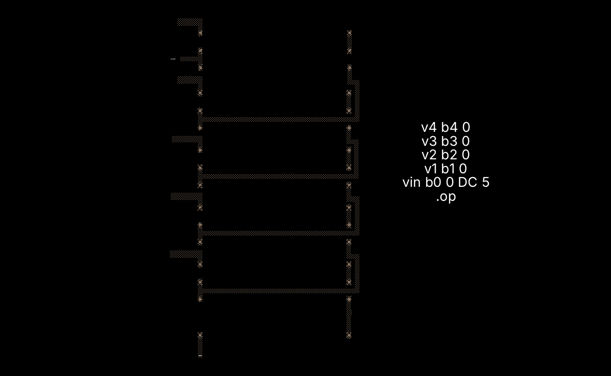

- Five R_divider cells stacked, plus the 10k to ground at the bottom.
- All the resistors have the same x position and different y positions, so they are stacked in a serpentine.
- All the input and output pins (b0 to b4, vout, gnd) are on metal 1.

### Serpentine layout, resistor connections

Zoomed in on the top of the DAC so the connections are easy to see:

Metal 1 connects the end of one resistor to the next one below it, so the path snakes back and forth down the stack.

3D view:

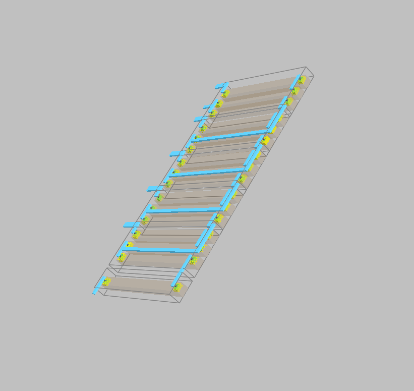

### DAC layout spice test

The layout card sets b0 = 5 V and the rest to 0 V (00001):

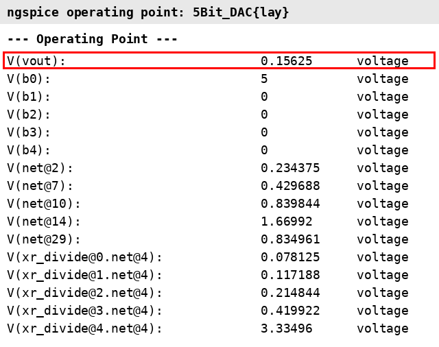

That is 1 LSB, so the layout works.

### DRC result

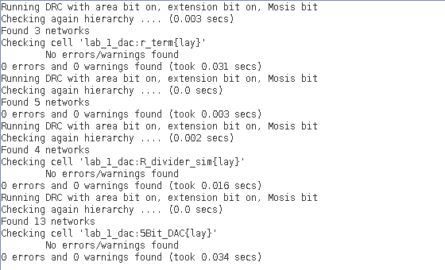

0 errors and 0 warnings on every layout cell.

### LVS (NCC) result

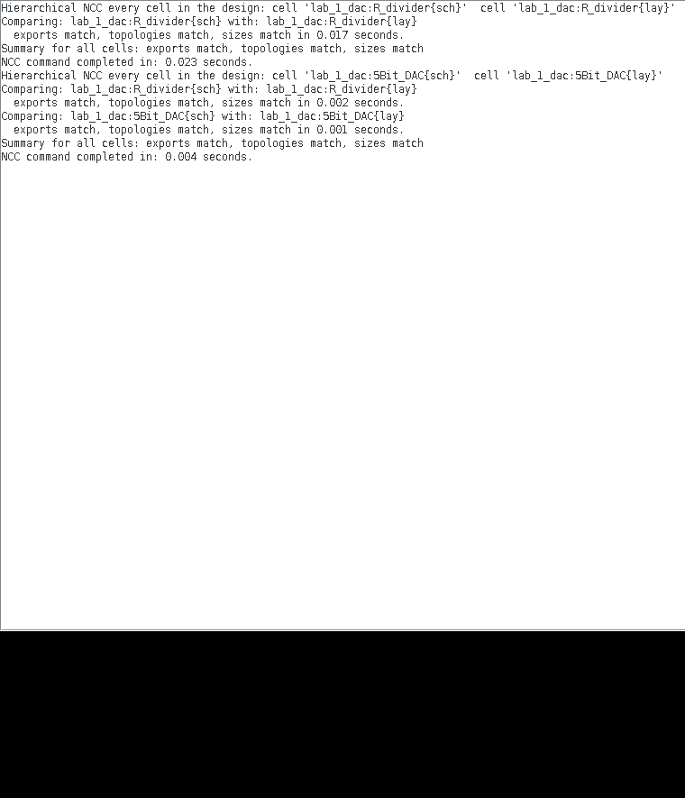

The schematic and layout match for R_divider and 5Bit_DAC.

## Files

| File | What it is |
|---|---|
| lab1.zip | Electric library (lab_1_dac.jelib) |
| images | Screenshots and plots |
