# CMOS Inverters

Ali Behbehani, VLSI, University of Denver, Fall 2026

Electric VLSI, mocmos, 300 nm scale, 3 metal layers. I drew the schematic, icon and layout for two inverters, found their switching points, and drove each one into 100 fF, 1 pF, 10 pF and 100 pF loads.

## Schematic

### Sizes

Sizes in Electric are in lambda, and λ = 300 nm.

| Inverter | PMOS W/L | NMOS W/L |
|---|---|---|
| inverter_1 | 12/6 | 6/6 |
| inverter_2 | 48/6 | 24/6 |

The PMOS is twice as wide as the NMOS because holes move slower than electrons, so a PMOS of the same width would be the weaker device. Doubling the width evens out the pull up and the pull down.

Inverter 2 is inverter 1 times four, so it can drive about four times the load at the same speed. The cost is four times the area.

### Inverter 1

inverter_1{sch} is the basic CMOS inverter. Both gates are tied together as the input and both drains are tied together as the output. The PMOS source goes to vdd and the NMOS source goes to gnd. in and out are Off-Page connectors. The spice models are named PMOS and NMOS to match C5_models.txt.

inverter_1{ic} is a triangle with a bubble, drawn with the artwork library. I put it in the schematic window next to the circuit.

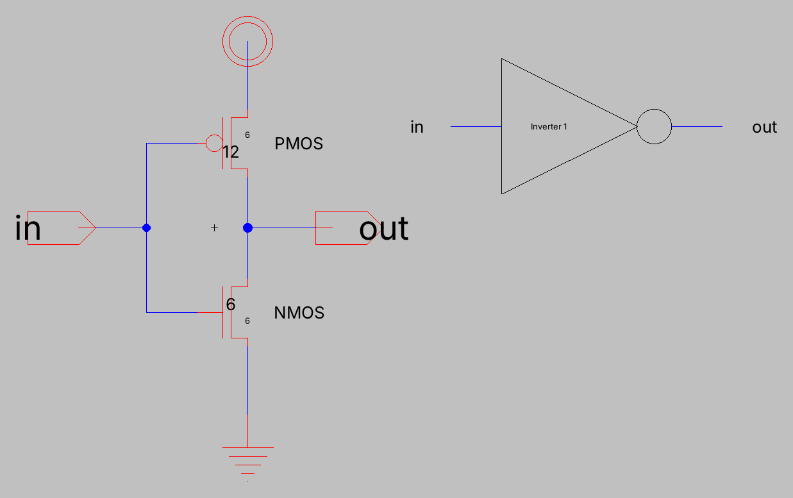

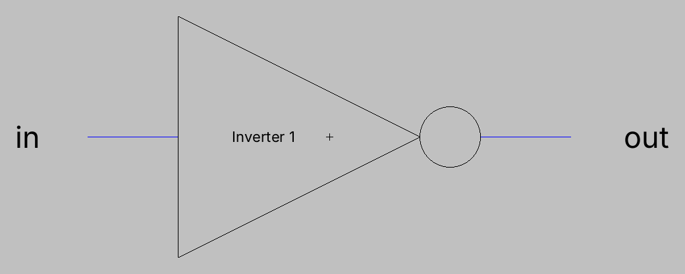

### Inverter 2

inverter_2{sch} is the same circuit with a 48/6 PMOS and a 24/6 NMOS.

The M = 4 multiplier is in the layout, where each transistor is four of the inverter 1 sized transistors in parallel. Four in parallel act like one transistor four times as wide, so the schematic shows one 48/6 and one 24/6.

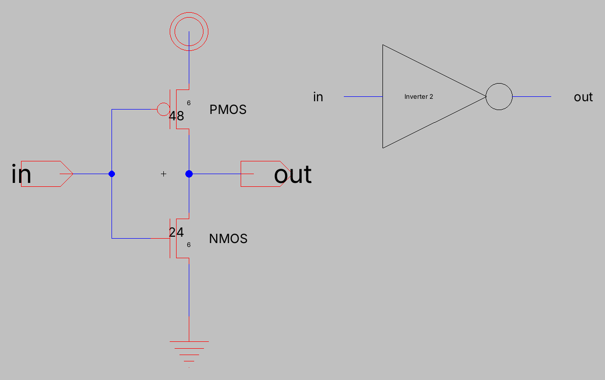


### Switching point

test_inverters{sch} drives both inverters from the same vin and sweeps it from 0 to 5 V:

```
vdd vdd 0 DC 5
vin vin 0 DC 0
.dc vin 0 5 1m
.include C5_models.txt
```

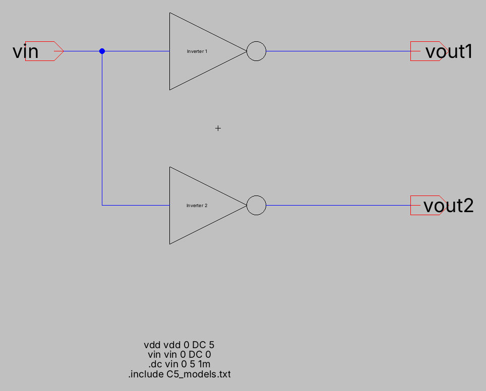

The switching point is where the output crosses the input.

| Inverter | Switching point |
|---|---|
| inverter_1 | 2.42 V |
| inverter_2 | 2.25 V |

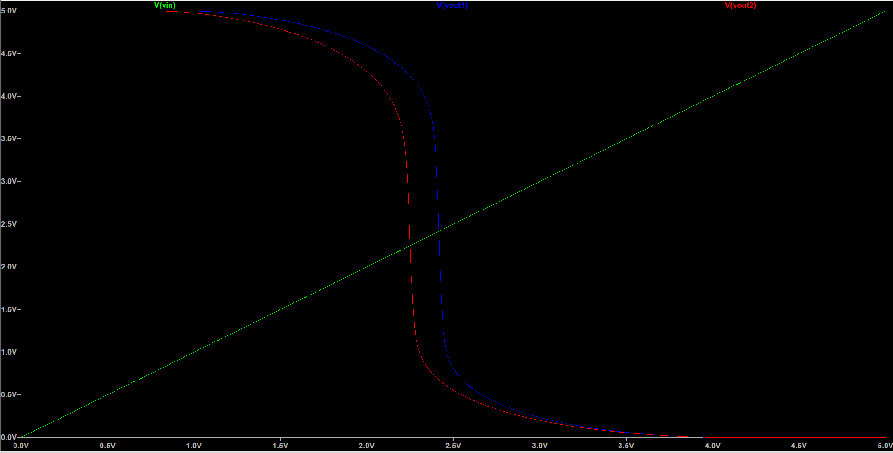

Both are a little under half of VDD. Even at twice the width the PMOS is still slightly weaker than the NMOS, so the output falls a bit before the input reaches 2.5 V.

Inverter 2 switches a little lower than inverter 1 even though the width ratio is the same. The two inverters are built from different sized transistors, and wider transistors lose less of their width in the model, so inverter 2's NMOS ends up relatively stronger.

### Capacitive loads

test_inverters_load{sch} puts a capacitor {x} on each output and steps it through the four loads:

```
vdd vdd 0 DC 5
vin vin 0 pulse(0v 5v 5n 1n 1n 12n 25n)
.step param x list 100f 1p 10p 100p
.tran 0 25n 0 100p
.include C5_models.txt
```

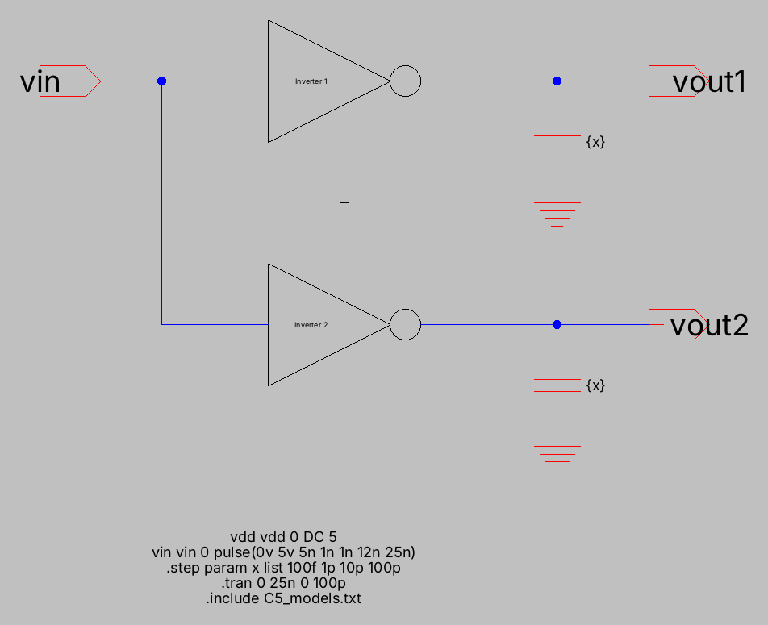

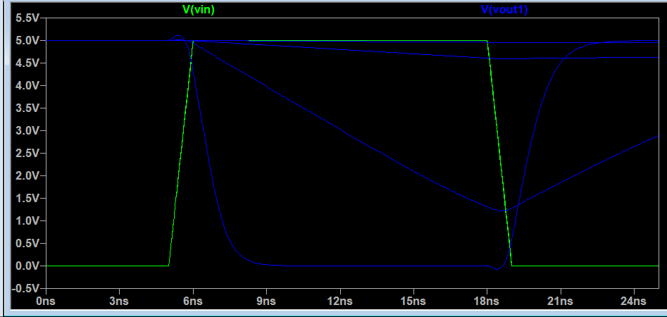

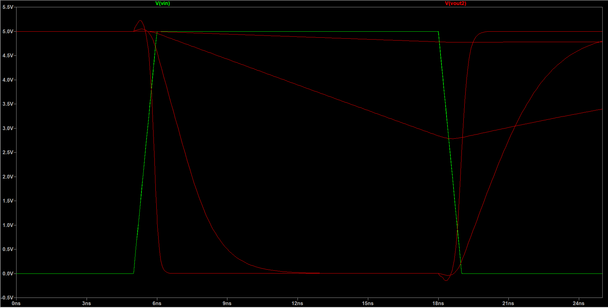

The bigger the capacitor, the longer the output takes to switch. At 100 fF both inverters switch all the way in about 2 ns. At 1 pF inverter 2 still makes it, but inverter 1 only gets down to about 1.3 V before the input goes back low. At 10 pF and 100 pF neither output has time to finish, so they just drift down a little and come back up.

25 ns is too short for the big loads to finish, so I made test_inverters_load_long{sch}. It is the same circuit with a 10 µs period, which gives every load time to settle:

```
vin vin 0 pulse(0v 5v 5n 1n 1n 5u 10u)
.tran 0 10u 0 1n
```

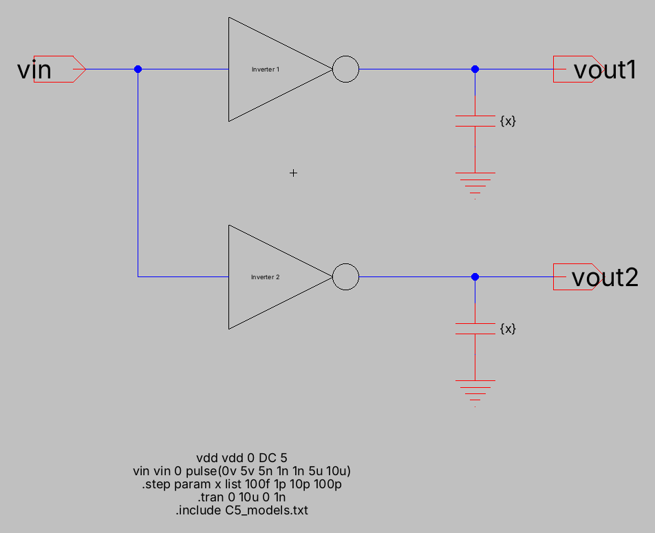

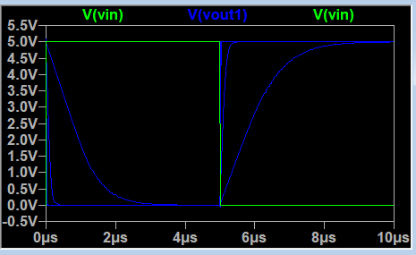

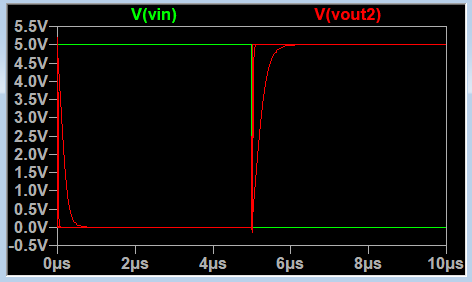

Delays, from vin crossing 2.5 V to the output crossing 2.5 V:

| Load | Inverter 1 tPHL | Inverter 1 tPLH | Inverter 2 tPHL | Inverter 2 tPLH |
|---|---|---|---|---|
| 100 fF | 1.09 ns | 1.22 ns | 0.40 ns | 0.52 ns |
| 1 pF | 8.26 ns | 9.28 ns | 1.78 ns | 2.44 ns |
| 10 pF | 79.9 ns | 89.9 ns | 15.4 ns | 21.3 ns |
| 100 pF | 796 ns | 896 ns | 152 ns | 210 ns |

What the numbers show:

- From 1 pF up, ten times the load gives ten times the delay. The delay is set by how long the transistor takes to charge or discharge the capacitor.
- Inverter 2 is about four to five times faster than inverter 1 at every load, which is what I expected from four transistors in parallel.
- The rise is always slower than the fall, because the PMOS is still a little weaker than the NMOS.
- At 100 fF the delay does not drop by another ten times. At that point the inverter's own capacitance matters as much as the load.
- With a 25 ns period, inverter 1 can handle about 100 fF and inverter 2 about 1 pF. A 100 pF load would need a much bigger driver than either one.

## Layout

### Inverter 1

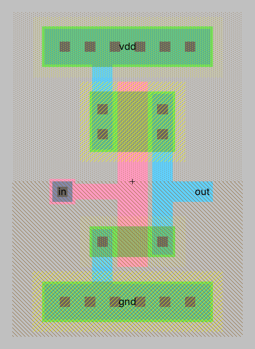

- vdd runs across the top of the cell on metal1 and gnd runs across the bottom on metal1, as the handout asks.
- Each rail is a long well contact with a row of cuts, n-well under vdd and p-well under gnd. That ties the n-well to VDD and the substrate to GND, so the transistor bodies are held at the right voltage.
- The PMOS sits in the n-well up top and the NMOS sits over gnd. One vertical poly line, 6λ wide, is the gate of both.
- The source contacts are on the left and run straight up to vdd and down to gnd. The drain contacts are on the right and are joined by a metal1 line that leaves the cell as out.
- in is a poly contact on the left, between the two transistors.
- The cell is 46λ by 65λ.

### Inverter 2

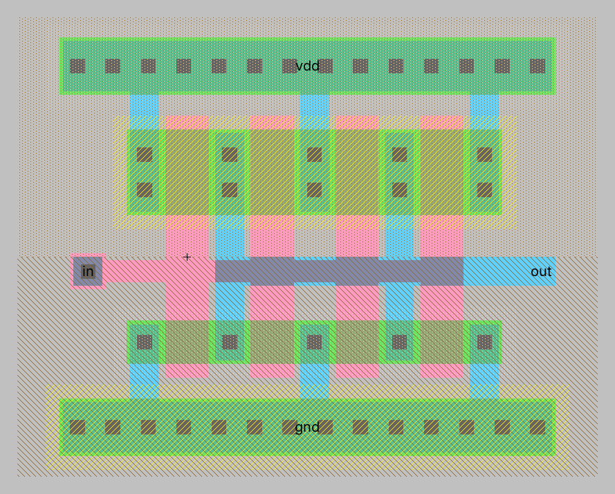

- Four fingers of the same size as inverter 1, side by side, on a 12λ pitch.
- Neighboring fingers share their diffusion contacts, so each row goes source, drain, source, drain, source. The source contacts go to the rails and the drain contacts are tied together on metal1 to out.
- The four gates are tied together by a horizontal poly bar in the middle, fed from the in contact on the left. The out line is metal1, so it crosses over the poly bar without connecting to it.
- I used four fingers instead of one wide transistor so the cell stays the same height as inverter 1. That way the vdd and gnd rails line up if the two cells sit next to each other.
- The cell is 82λ by 65λ.

## DRC

Tools > DRC > Check Hierarchically on each layout: 0 errors, 0 warnings for both.

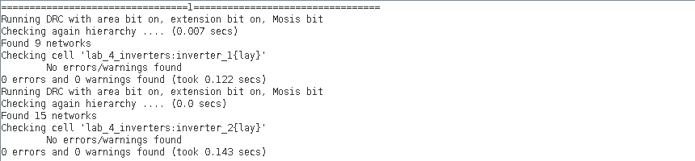

## NCC

Tools > NCC > Schematic and Layout Views of Cell in Current Window on each layout: exports, topologies and sizes match for both. For inverter 2 this confirms the four fingers add up to the 48/6 and 24/6 in the schematic.

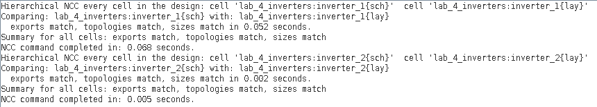

## Files

| File | Contents |
|---|---|
| Files/lab_4_inverters.jelib | inverter_1 and inverter_2 (sch, ic, lay), test_inverters, test_inverters_load, test_inverters_load_long |
| Files/C5_models.txt | Transistor models for the spice cards, keep it in the same folder as the .jelib |
| pictures/ | Screenshots and plots |
