# Full Adder

Ali Behbehani, VLSI, University of Denver, Fall 2026

Electric VLSI, mocmos, 300 nm scale, 3 metal layers. Part 1 is a NAND, a NOT and an XOR built as standard cells. Part 2 puts five of those cells side by side to make a full adder.

## Part 1

### Sizes

Every transistor in this lab is 6/2, so W = 6λ and L = 2λ. With λ = 300 nm that is 1.8 µm wide and 0.6 µm long. The handout asks for the same size on the NMOS and the PMOS, so I did not make the PMOS wider like I did in Lab 4. That means the pull up is a bit weaker than the pull down, so the outputs rise slightly slower than they fall.

### The standard cell frame

All three gates use the same frame so they can be placed end to end:

- Every cell is the same height. vdd is 26λ above the middle of the cell and gnd is 26λ below it, the PMOS row is 11λ above the middle and the NMOS row is 11λ below.
- vdd runs across the top and gnd across the bottom, each one a strip of well contacts with metal1 on top, n-well under vdd and p-well under gnd, so the rails also hold the transistor bodies at the right voltage.
- The rail metal reaches the left and right edges of the cell, so cells placed next to each other can have their rails joined with a straight piece of metal1.
- The well contacts stop 4λ short of the cell edges, so the contact cuts of two cells never end up too close together.
- Inside a row the gates are 8λ apart, with a contact 4λ either side of a gate where one is needed.
- Between each transistor row and its rail there is a gap I use as a poly lane, so signals can run along the cell on poly without getting in the way of the metal1.
- The gate inputs come in on poly from the edges of the cell, ending on a poly contact so the pin is on metal1. A, B, Y, vdd and gnd are all on metal1.

### NAND

The two PMOS are in parallel between vdd and the output, and the two NMOS are in series between the output and gnd. So the output is only pulled low when both inputs are high, which is NAND.

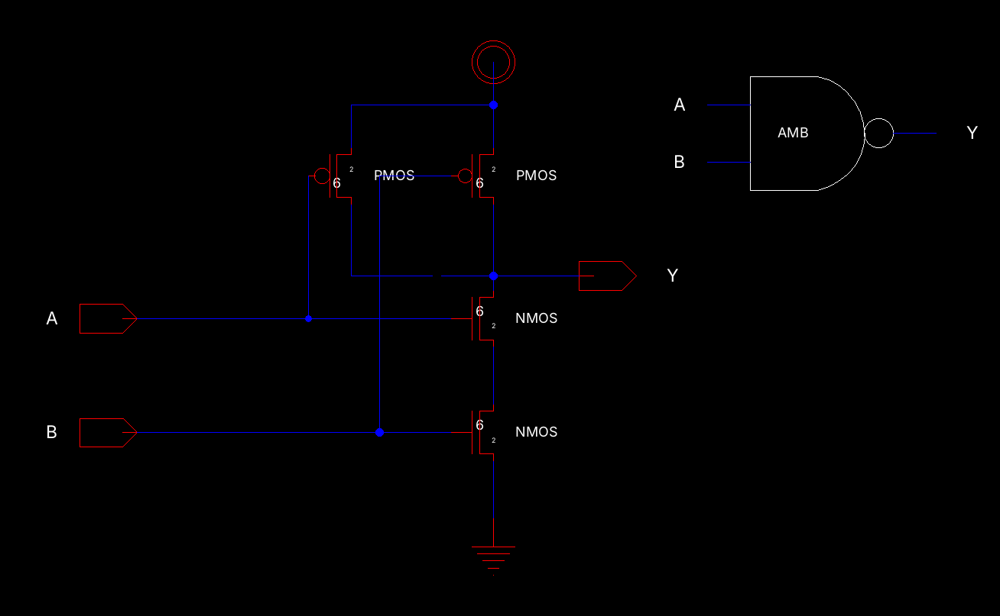

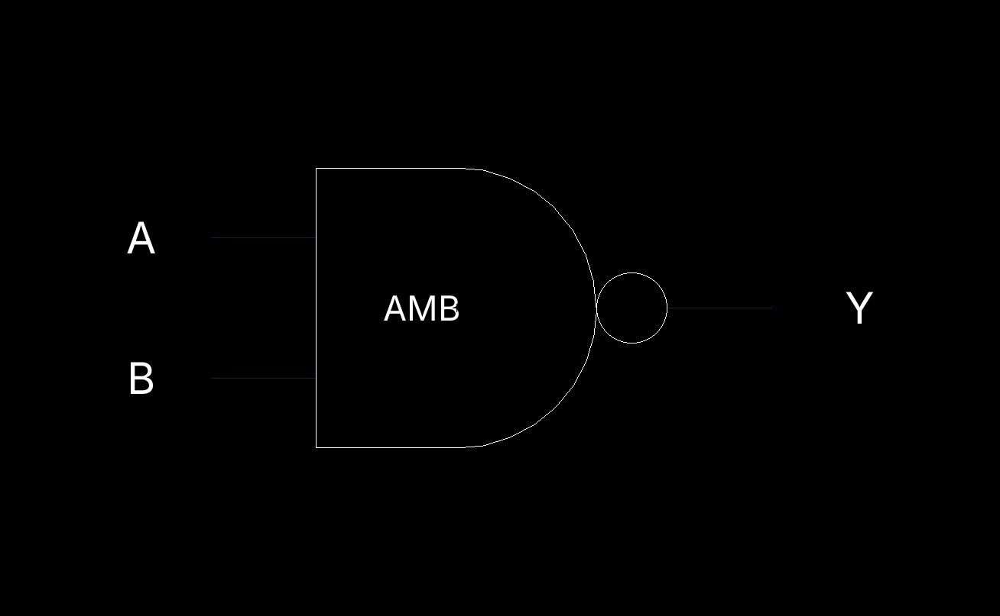

In the layout the cell is 36λ wide. The two PMOS share one strip of p-active, and the two NMOS share one strip of n-active. The middle contact on the PMOS row is the output and the two outer ones go to vdd. On the NMOS row the left contact goes to gnd and the right one is the output. The node between the two series NMOS does not go anywhere, so it has no contact and the active just runs straight through. Each input is one vertical poly line that runs through both rows, so one gate line drives the PMOS and the NMOS together. B comes in on poly from the left edge and A from the right edge, and Y drops from the PMOS middle contact, crosses the channel and goes down to the NMOS right contact.

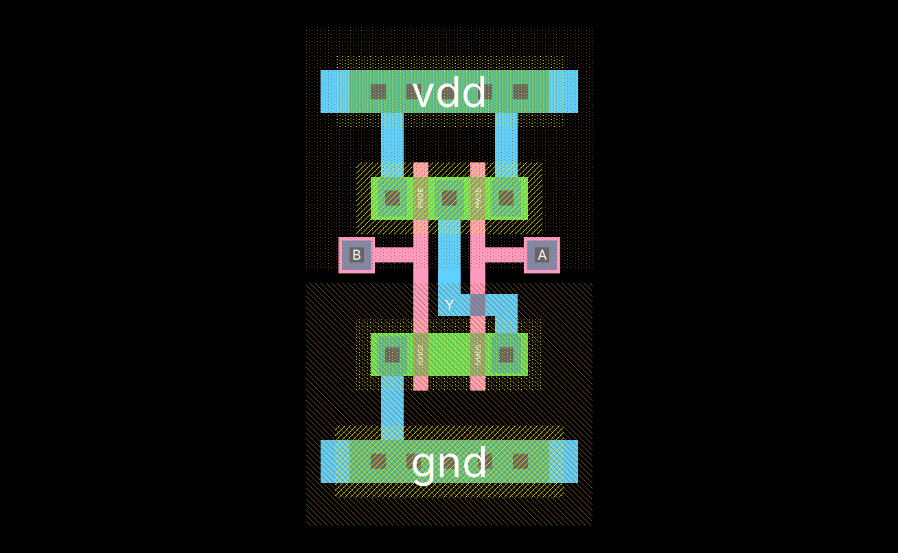

The same layout in Electric's 3D view:

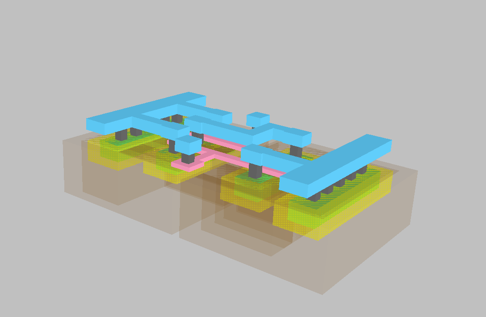

### NOT

One PMOS over one NMOS with the gates tied together. Same frame, 28λ wide. A comes in on poly from the left, and Y runs straight down the right hand column from the PMOS contact to the NMOS contact.

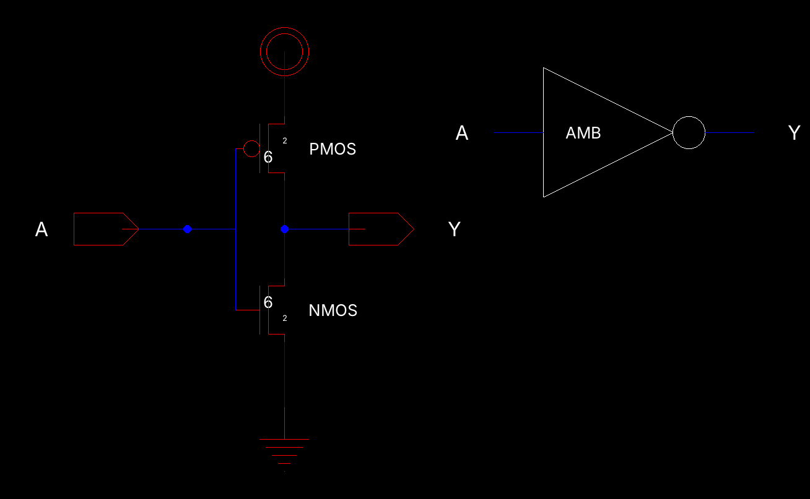

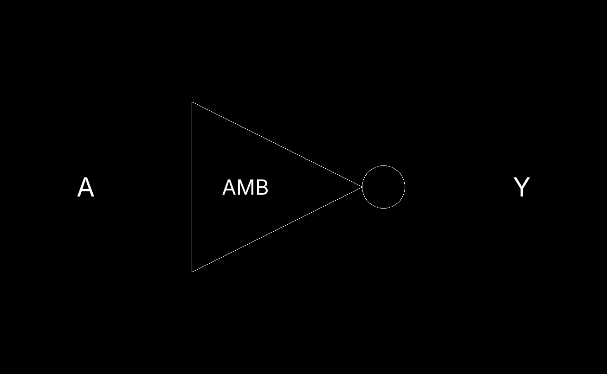

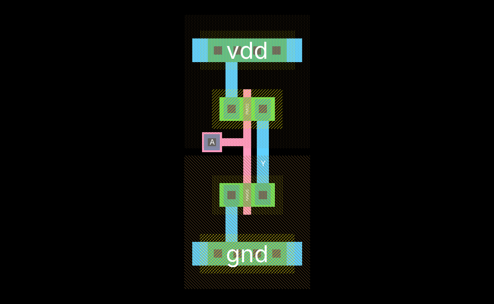

The same layout in Electric's 3D view:

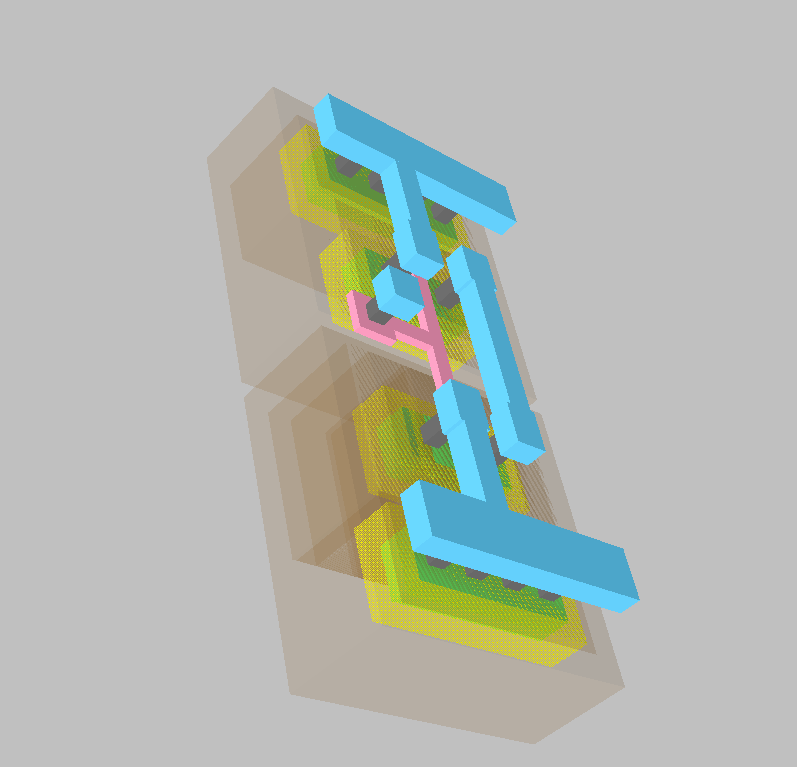

### XOR

I built the XOR the way the class notes do it, with two inverters and an eight transistor block, twelve transistors in total. Building it out of four NAND gates would have taken sixteen.

The eight transistor block works like this. The output is pulled high through two series PMOS pairs in parallel, one pair gated by A and notB, the other by B and notA. It is pulled low through two series NMOS pairs, one gated by A and B, the other by notB and notA. So the output goes high when exactly one input is high and low when the two inputs are the same.

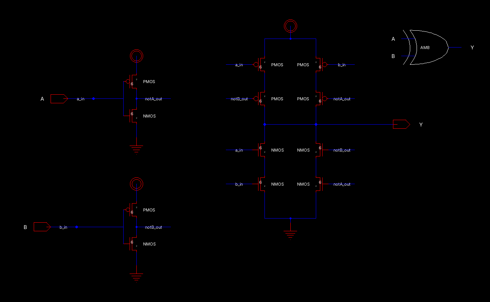

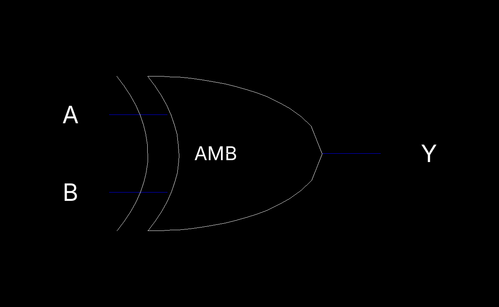

In the layout the cell is 100λ wide. Inverter A is at the left end, inverter B is at the right end and the eight transistor block sits between them. A comes in on poly from the left edge and B from the right edge.

In the block, the four gate columns from left to right are A, notB, notA and B, and each column is one continuous piece of poly through both rows. On the PMOS row that gives vdd, A, notB, Y, notA, B, vdd, so the two series pairs share the Y contact in the middle and the internal nodes between each pair need no contact. On the NMOS row the order is the same, but the series pairs have to be A with B and notB with notA. notB and notA sit next to each other, so that pair runs from Y down to gnd in the middle of the row. A and B end up at the two ends of the row, so their outer contacts are joined with a short metal2 bar through the middle of the cell.

The four signals get to their columns like this:

- A runs along the poly lane under the NMOS row from inverter A over to its column
- notA goes from inverter A's output up through a poly contact and along the lane above the PMOS row
- B runs along the lane above the PMOS row from inverter B over to its column
- notB goes from inverter B's output down through a poly contact and along the lane under the NMOS row

Because those four runs are all on poly in the lanes, the middle channel only has the Y bar on metal1 and the metal2 bar in it.

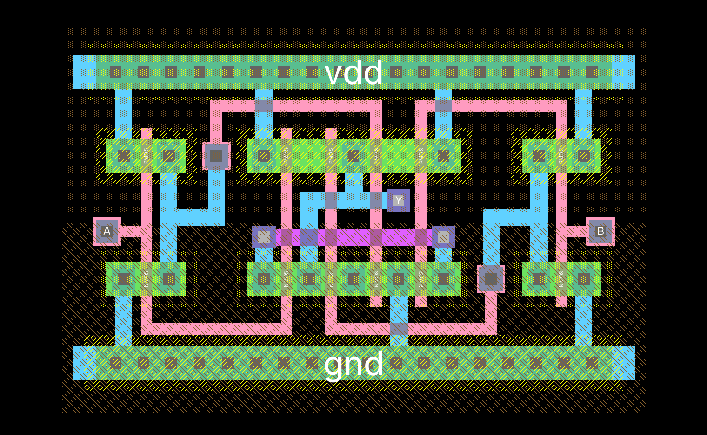

The same layout in Electric's 3D view:

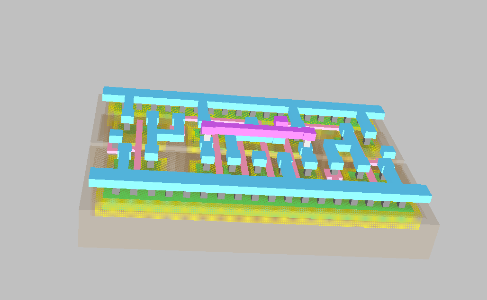

### Simulating the gates

All three gates share one input pair. Both inputs run on the same 20 ns period but B starts 5 ns after A, so the two of them step through all four combinations inside each period.

```
vdd vdd 0 dc 5
va va 0 pulse(0v 5v 0n 1n 1n 10n 20n)
vb vb 0 pulse(0v 5v 5n 1n 1n 10n 20n)
.tran 0 40n
.include C5_models.txt
```

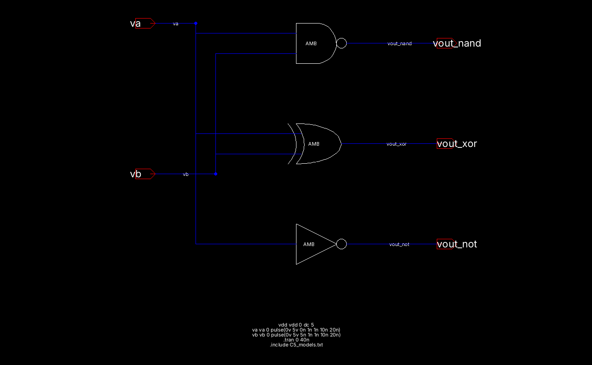

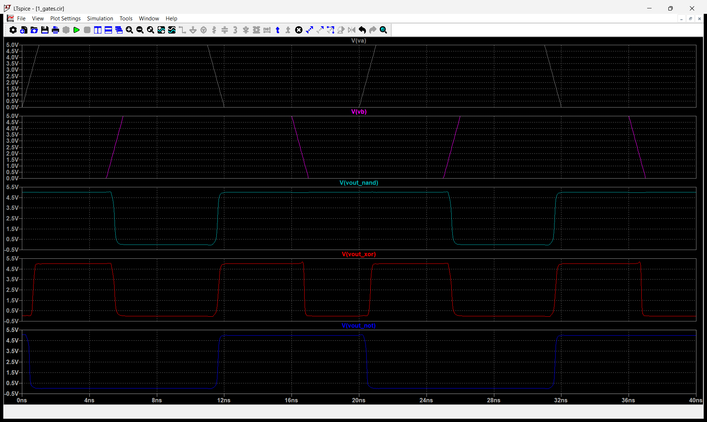

Reading the four windows gives the truth tables I expected:

| time | A | B | NAND | XOR | NOT A |
|---|---|---|---|---|---|
| 0 to 5 ns | 1 | 0 | 1 | 1 | 0 |
| 5 to 10 ns | 1 | 1 | 0 | 0 | 0 |
| 10 to 15 ns | 0 | 1 | 1 | 1 | 1 |
| 15 to 20 ns | 0 | 0 | 1 | 0 | 1 |

The second half of the run from 20 to 40 ns is the same four windows again.

### Transition delays

I also gave each gate its own test with one input pulsed from 0 to 5 V at 10 ns. On the NAND and the XOR the other input is tied to vdd, so both of them act as inverters, which makes it easy to see the output switch right after the input.

```
vdd vdd 0 dc 5
vin d_in 0 pulse(0v 5v 10n 1n 1n 40n 40n)
.tran 0 40n
.include C5_models.txt
```

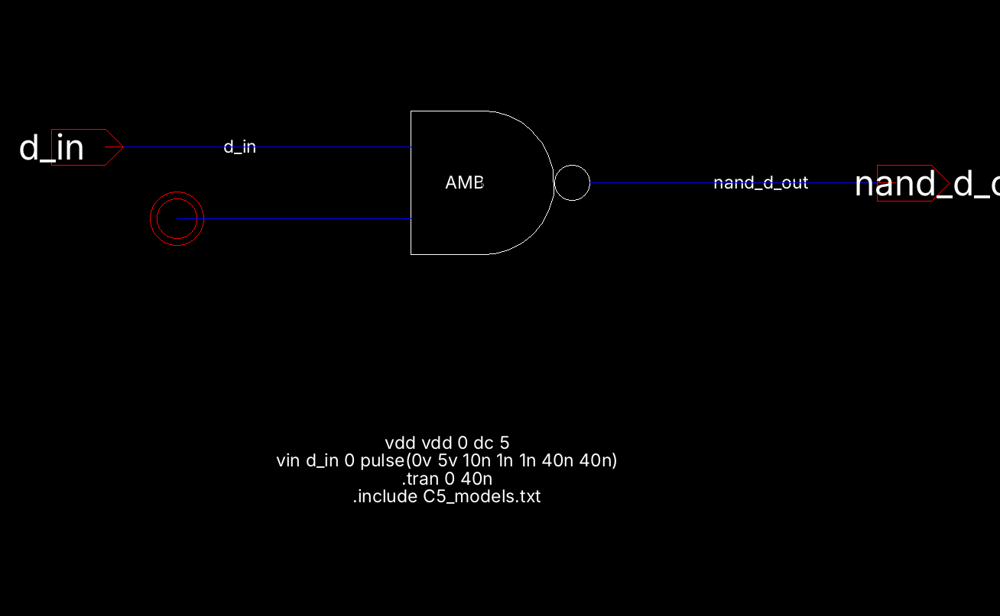

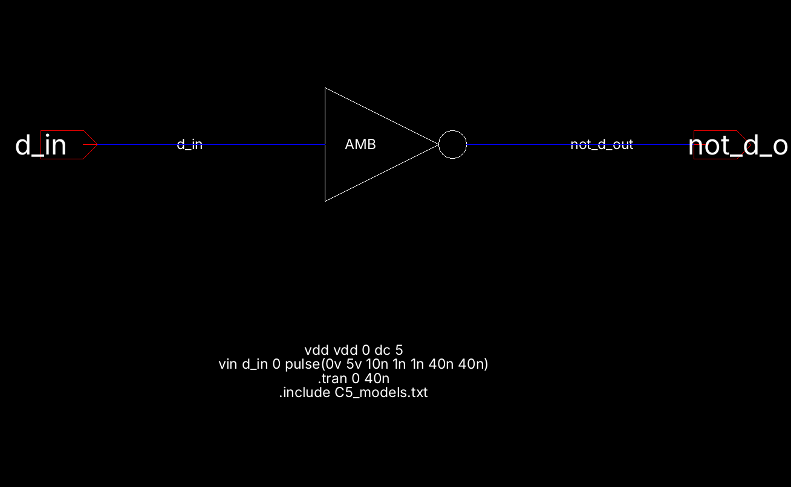

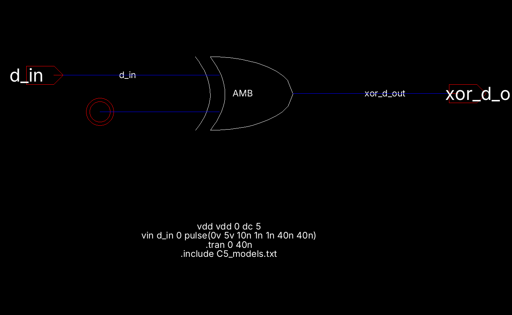

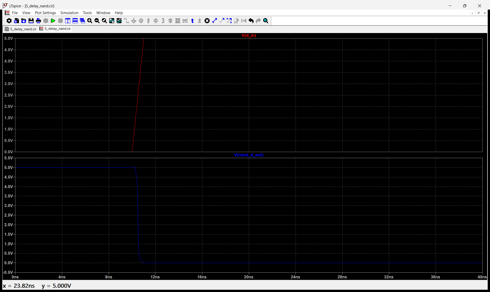


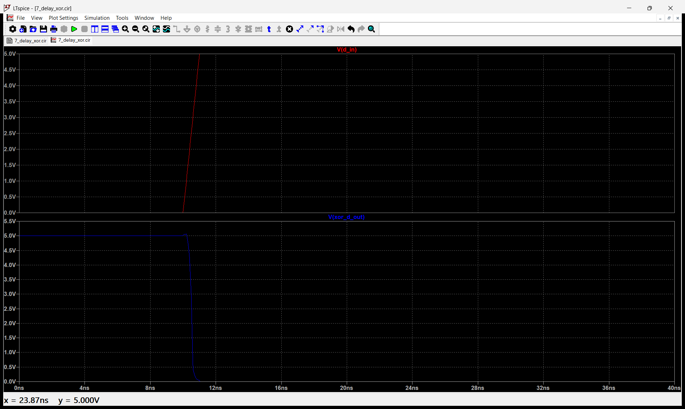

All three outputs start at 5 V and fall to 0 V as d_in rises. There is no load on the outputs here, so the delay is only a fraction of a nanosecond.

### Glitches from input timing

A gate only gives the right answer once all of its inputs have settled. If two inputs are supposed to change at the same moment but one arrives late, then for that short gap the gate sees an input pattern that was never meant to happen, and it drives the output to match it. That short wrong pulse is a glitch.

To show it I took the XOR and switched both inputs from 0 to 1 at the same time, except B arrives 2 ns after A. XOR of 0,0 is 0 and XOR of 1,1 is 0, so the output should stay low the whole time. Instead it goes all the way to 5 V for about 2 ns, because in between the gate really does see A = 1 and B = 0. The same thing happens again at 30 ns when both inputs fall, since B also falls 2 ns after A.

```
vga ga 0 pulse(0v 5v 10n 1n 1n 20n 40n)
vgb gb 0 pulse(0v 5v 12n 1n 1n 20n 40n)
.tran 0 40n 0 20p
```

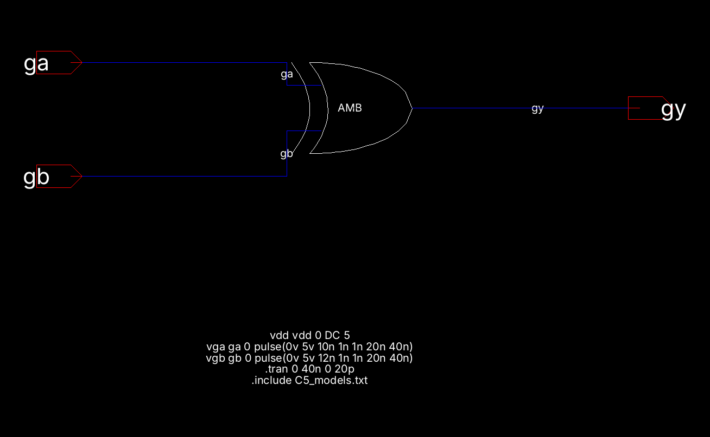

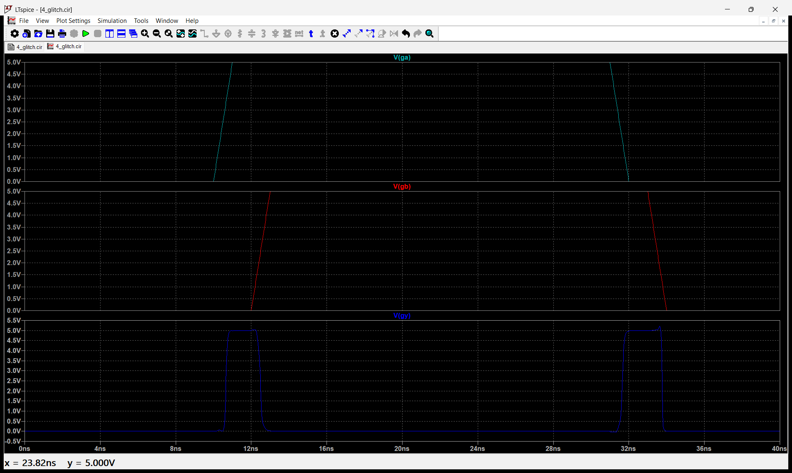

The glitch is as wide as the skew between the inputs. The same thing shows up in my full adder further down, where the narrow spikes on s and cout appear at the moments when more than one input changes at once, because the signals take different numbers of gates to arrive. The glitches settle on their own, so the answer is still right once everything has caught up. They matter because they waste power and because anything reading the output has to wait until the circuit has settled before trusting it.

## Part 2

### Schematic

The full adder is two XOR gates and three NAND gates:

- s = A xor B xor Cin, so one XOR makes A xor B and the second one adds Cin
- cout = NAND( NAND(A,B), NAND(Cin, A xor B) ), which is AB + (A xor B)Cin

I placed the gates on the page the same way as the handout, with Cin, A and B coming in on the left, xor1 in the middle, xor2 at the top right and the three NANDs underneath.

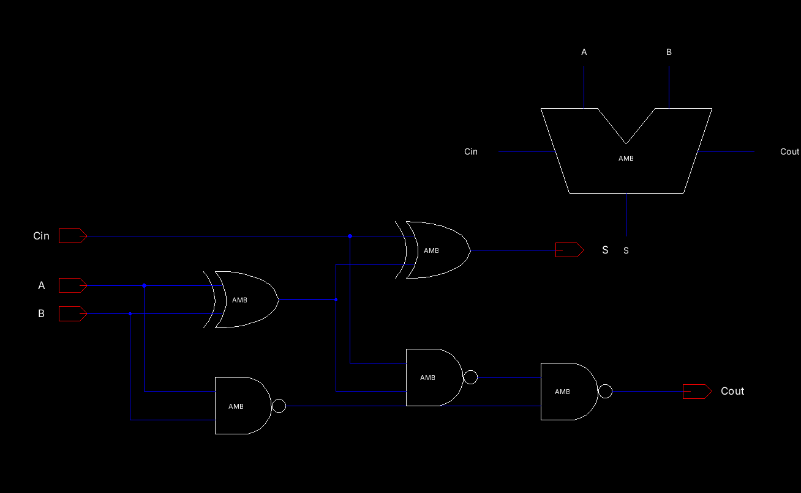

### Symbol

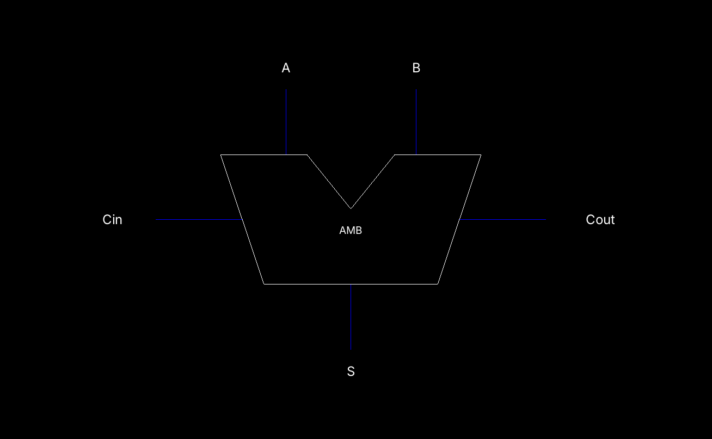

### Layout

The five cells are placed end to end in one row in the order NAND, XOR, NAND, NAND, XOR. That puts each gate next to the gates it talks to: nand1 and xor1 both take A and B, then nand2 and nand3 make the carry, and xor2 makes the sum at the end. I left a small gap between the cells so the vertical wires have somewhere to go, and the vdd and gnd rails are joined across each gap with metal1, so power runs the whole length of the row.

For the signals between the gates I used metal1 for the horizontal runs and metal2 for the vertical ones, so two wires can cross without shorting. The routing:

- A comes in from the top, drops on metal2 in the gap after nand1, and goes into nand1 A and xor1 A
- B comes in from the left into nand1 B, then runs along a channel under the row and comes up into xor1 B
- n1, the xor1 output, goes right on metal2 into nand2 B, and also up to a channel above the row and over to xor2 B
- Cin comes in from the top, drops into xor2 A, with a branch over to nand2 A
- the nand1 and nand2 outputs drop to the channels under the row and come back up into nand3
- Cout comes out of nand3 and leaves through the bottom, and S comes out of xor2 and leaves on the right

The handout allows metal2 for the adder inputs and outputs, and I did not use metal3 anywhere.

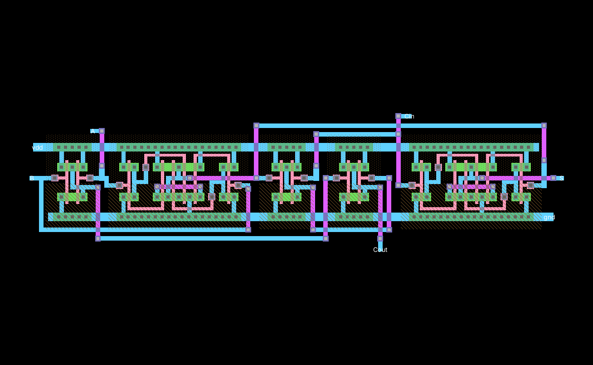

The same layout in Electric's 3D view:

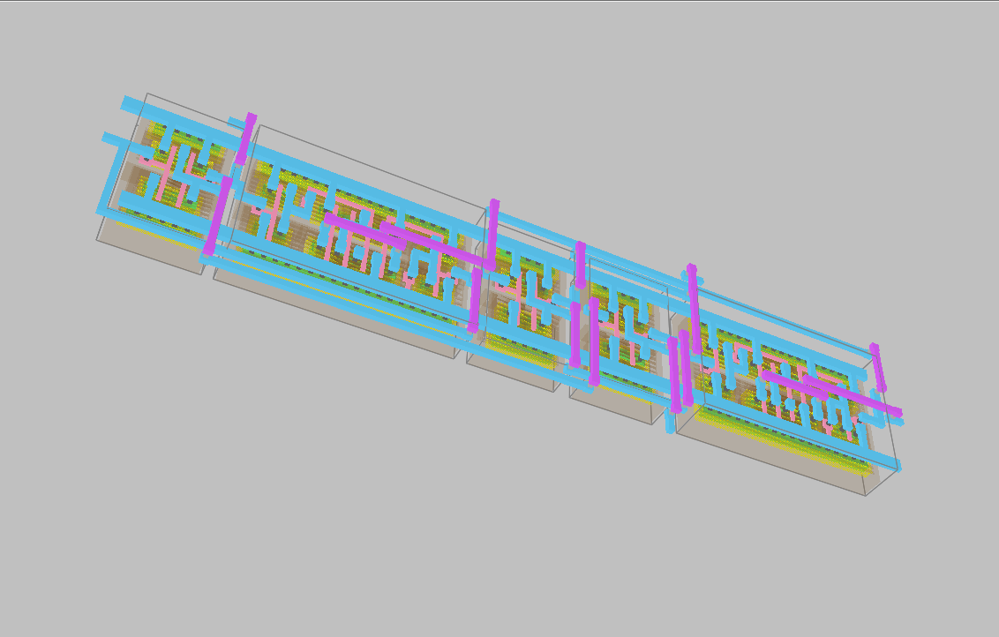

### Simulating the full adder

I ran the adder two ways.

The first one uses the same idea as the gates. All three inputs run on a 20 ns period, offset from each other, over 60 ns.

```
vdd vdd 0 dc 5
va a 0 pulse(0v 5v 0n 1n 1n 10n 20n)
vb b 0 pulse(0v 5v 5n 1n 1n 10n 20n)
vcin cin 0 pulse(0v 5v 2n 1n 1n 10n 20n)
.tran 0 60n
.include C5_models.txt
```

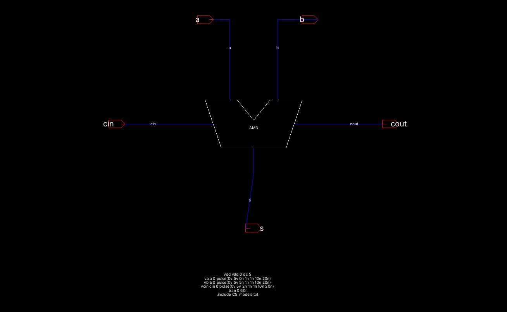

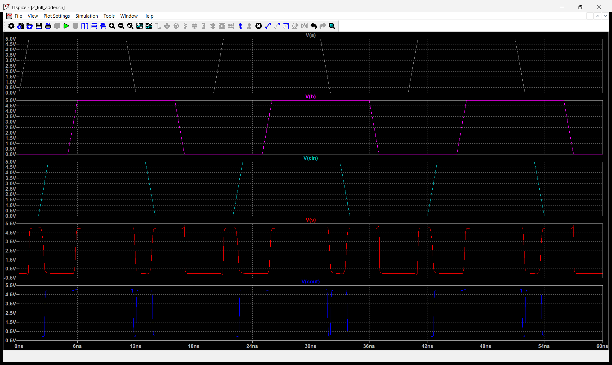

This one is quick to read but it does not show every row. Because all three inputs share the same period, the pattern repeats every 20 ns, so only six of the eight combinations ever appear, and two of those last so briefly that the output has not finished settling before the next input changes.

So I also ran it a second way, with each input at half the speed of the one below it. That steps through all eight combinations in binary order over 160 ns, and gives each one long enough to settle.

```
vdd vdd 0 dc 5
va a 0 pulse(0v 5v 0n 1n 1n 80n 160n)
vb b 0 pulse(0v 5v 0n 1n 1n 40n 80n)
vcin cin 0 pulse(0v 5v 0n 1n 1n 20n 40n)
.tran 0 160n 0 100p
.include C5_models.txt
```


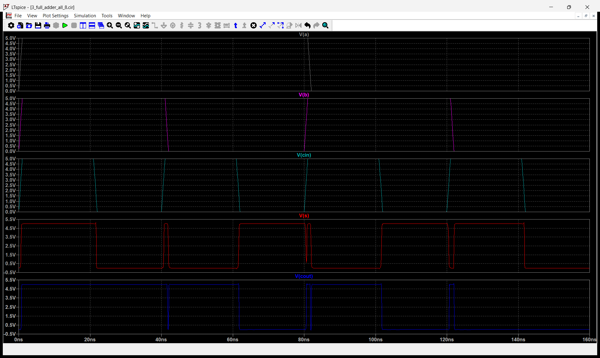

All eight rows come out matching the truth table in the handout:

| a | b | cin | cout | s |
|---|---|---|---|---|
| 0 | 0 | 0 | 0 | 0 |
| 0 | 0 | 1 | 0 | 1 |
| 0 | 1 | 0 | 0 | 1 |
| 0 | 1 | 1 | 1 | 0 |
| 1 | 0 | 0 | 0 | 1 |
| 1 | 0 | 1 | 1 | 0 |
| 1 | 1 | 0 | 1 | 0 |
| 1 | 1 | 1 | 1 | 1 |

The narrow spikes on s and cout in both runs are the glitches from the section above. They happen where two or three inputs change together and one path through the adder is slower than another.

## DRC

Tools > DRC > Check Hierarchically on each layout: 0 errors and 0 warnings on all four.

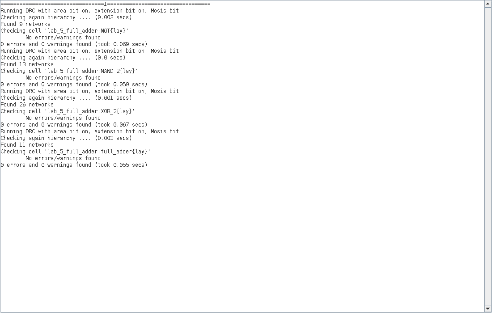

## NCC

Tools > NCC > Schematic and Layout Views of Cell in Current Window on each layout, with size checking on. Exports, topologies and sizes match on all four. Running it on the full adder also re-checks the NAND and XOR cells inside it.

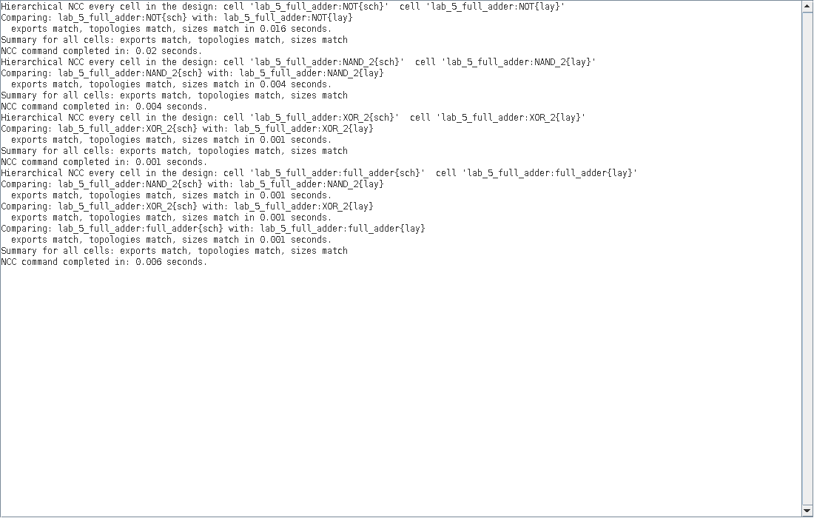

## Files

| File | Contents |
|---|---|
| Files/lab_5_full_adder.jelib | NAND_2, NOT, XOR_2 and full_adder (sch, ic, lay for each), plus the simulation cells |
| Files/C5_models.txt | Transistor models for the spice cards, keep it in the same folder as the .jelib |
| LTspice/ | The netlists Electric wrote, ready to open in LTspice, with the models. 1_gates, 2_full_adder, 3_full_adder_all_8, 4_glitch, 5_delay_nand, 6_delay_not and 7_delay_xor |
| pictures/ | Screenshots and plots |
